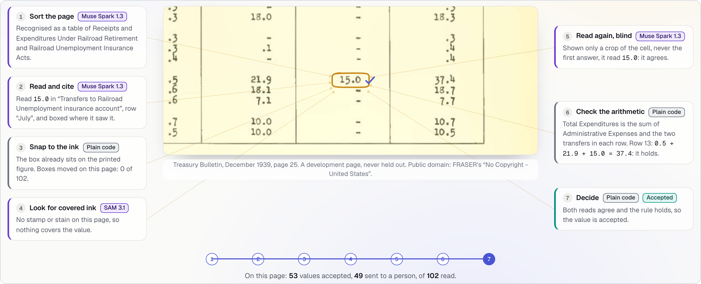
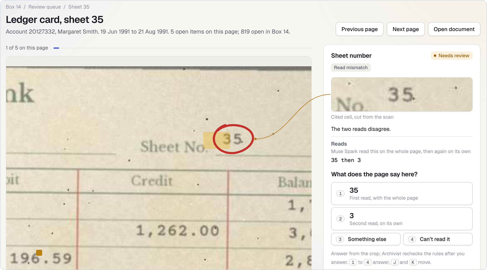
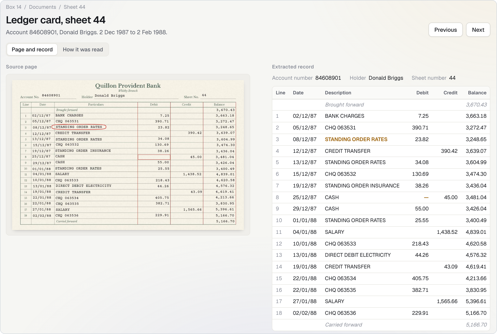

<h1 align="center"> Archivist</h1>

<div align="center">

**The archive that shows its work.**

[](https://kamil-shirinov.github.io/Archivist/) [](https://github.com/kamil-shirinov/Archivist/actions/workflows/ci.yml) [](LICENSE) [](#run-it-yourself) [](#metas-four-models) [](#open-weights-the-same-pipeline-on-your-own-hardware) [](#metas-four-models) [](#metas-four-models)

Built with the Meta Model API (Muse Spark 1.3, SAM 3.1), Muse Spark Open on Baseten, and Muse Glimmer on Modal.

<picture>
  <source media="(prefers-reduced-motion: reduce) and (prefers-color-scheme: dark)" srcset="docs/img/banner-still-dark.svg">
  <source media="(prefers-reduced-motion: reduce)" srcset="docs/img/banner-still-light.svg">
  <source media="(prefers-color-scheme: dark)" srcset="docs/img/banner-dark.svg">
  
</picture>

**[12× fewer wrong values than Muse Spark reading alone](#results)**

0.36% against 4.45% on a pre-registered test of 4,267 values from 157 synthetic bank pages. Archivist sends about 1 in 5 values to a person to decide, and open weights do as well (0.30%).

[Start here](#start-here) · [For judges](#for-judges) · [The problem](#the-problem) · [What you get](#what-you-get) · [How it works](#how-it-works) · [Open weights](#open-weights-the-same-pipeline-on-your-own-hardware) · [Results](#results) · [Why you can trust the numbers](#why-you-can-trust-the-numbers) · [Run it yourself](#run-it-yourself)

</div>

- **What it does.** Archivist turns scanned financial archives into a verified database. Every value is cited to its spot on the page, cross-checked by arithmetic and a blind second read, and flagged for a person when unsure. Values are never changed automatically.
- **How well.** Every target was pre-registered, and the misses are reported: three of the synthetic test's five targets were met. On real government scans the target was not met with every cell counted, and was met only on pages whose layout matches their template, under the corrected key ([Results](#results), [Honest limits](#honest-limits)).
- **Where your data goes.** Hosted, pages go to Meta's Model API, and Muse Glimmer's page sorting runs on Modal GPUs. On your own hardware, Muse Spark Open reads in their place, so a bank that cannot send documents out can keep them: not yet proven on-site ([open weights](#open-weights-the-same-pipeline-on-your-own-hardware)). Only synthetic or public-domain pages were ever sent to a model, and the demo is static: no key, no server, no model call.

**Built during the hackathon.** A solo entry by Kamil Shirinov (Indie Developer track, Build for Your World). The idea came from a bank internship. Everything in this repository was built from its first commit, `dd55660` on 26 Oct 2026, except the third-party components named under Credits at the end.

## Start here

| | |
|---|---|
| **Watch** | The [demo video](https://youtu.be/iRVeZBQxxP4) |
| **Try** | The [live demo](https://kamil-shirinov.github.io/Archivist/) (a landing page, then the review app) and [Watch it work](https://kamil-shirinov.github.io/Archivist/ui/#replay), the recorded read of one page, value by value |
| **Run** | `docker build -t archivist .`, then `docker run --rm -p 8000:8000 archivist` for the site and `docker run --rm archivist python -m archivist.verify` for the judge checks ([Run it yourself](#run-it-yourself)) |
| **Read** | [eval/README.md](eval/README.md), how every number was measured and how to reproduce it · the plans written before the runs: [synthetic](PREREGISTRATION.md), [real scans](PREREGISTRATION_REAL.md), [open weights](PREREGISTRATION_OPENW.md) · [the diagnosis of the real-scan errors](results/real_test/held_out/diagnosis.md) · [DECISIONS.md](DECISIONS.md) |

## For judges

| Criterion | Evidence |
|---|---|
| **Impact** (30%) | Banks hold decades of records as scans and paper; Archivist turns them into a database in which every value points to its spot on the page and a doubtful one goes to a person.<br>**Synthetic test:** it let in 0.36% wrong values against 4.45% for one read and caught 93.65% of the wrong ones ([Results](#results)).<br>**Real government scans:** with every cell counted its target was not met: under the corrected key, 16.3% (6.1%–33.3%) of the values it accepted were wrong against 27.8% (16.0%–40.9%) for one read, on all 400 labelled cells (36.9% (24.7%–50.4%) against 41.1% (30.6%–52.4%) as registered, before a labelling error was fixed by a rule written down first). It was met on pages whose layout matches their template, 0.0% against 3.2%; the [diagnosis](results/real_test/held_out/diagnosis.md) says why the rest went wrong ([Honest limits](#honest-limits)).<br>One `docker run` shows it with no key, and the code is open source under Apache-2.0. |
| **Use of Meta's models** (25%) | All four, each in a job that was measured: Muse Spark 1.3 reads and re-reads, SAM 3.1 finds covered ink, untrained Muse Glimmer sorts pages (it found all 136 confirmed table pages among 791 held-out ones), and Muse Spark Open does both reads on open weights ([Meta's four models](#metas-four-models), [open weights](#open-weights-the-same-pipeline-on-your-own-hardware)). What each one taught me, and what I dropped: [What I learned](#what-i-learned-about-metas-models), [What I tried and dropped](#what-i-tried-and-dropped). |
| **Demo** (25%) | The [live demo](https://kamil-shirinov.github.io/Archivist/) and [Watch it work](https://kamil-shirinov.github.io/Archivist/ui/#replay) replay recorded runs; `docker run` serves the same site; the [video](https://youtu.be/iRVeZBQxxP4). A local app reads a page with real model calls, each one listed as it happens ([live reading](docs/live-reading.md)). |
| **Technical depth** (20%) | No model grades its own work: plain-code arithmetic checks every value, and a person decides anything in doubt. New table types are learned from two or three sample pages with no new code: Muse Spark drafts, arithmetic tests, and a person approves. Each plan was committed before the runs it governs ([Why you can trust the numbers](#why-you-can-trust-the-numbers)); one command rebuilds the published numbers and charts from the committed runs and compares them byte for byte ([Run it yourself](#run-it-yourself)); [how every number was measured](eval/README.md). |

## The problem

During a bank internship I used AI to build two things: a parser that turned about 2,000 legacy memos into a clean spreadsheet database, and a working prototype of an automated loan-processing system. Both hit the same wall. Nobody held all the memos in one place, there was no archive, and the oldest records existed only on paper; businesses applying for loans brought their earnings in notebooks and loose sheets that staff typed in by hand. Archivist is the tool I wanted then: it turns scanned financial records into a verified database, with every value cited to its spot on the page, read twice, checked by arithmetic, and sent to a person when in doubt.

From that bank to this repo. A bank's own records are private, and Archivist only ever sends a model synthetic or public-domain pages, so it was tested on the closest honest stand-ins: synthetic ledger cards and the payment memos that reference them, generated so that every right answer is known; and real scans of the US Treasury Bulletin from 1939 to 1994, decades of typewritten financial tables with the problems an old archive has: faded ink, marks over the print, and layouts that change from year to year. Each new kind of table is a template that Muse Spark drafts from two or three sample pages and a person approves, with no new code. Handwritten notebooks are next: the method stays the same, but it hasn't been measured on them yet.

Solo entry by Kamil Shirinov for the Meta Global AI Developer Hackathon 2026: Indie Developer track, Build for Your World.

## What you get

Archivist reads two kinds of page: synthetic ledger cards with their payment memos (the collection the app calls Box 14), and tables from three public-domain government archives. It gives you:

- **A verified database, every value cited.** One command writes SQLite and CSV files for a run (`exports/<run>/`): accounts, documents, transactions, memos, field values and the links between them. Each value row keeps its page, its box on the scan, the checks it went through, why it was sent to a person, and any correction proposed. Two exports are committed.
- **A review queue.** The values the checks could not settle, one at a time: the page with the value ringed, the cell cut from the scan, and what each read and each rule said. A reviewer picks a read, types what the page says or marks it unreadable. The answer stays in that browser.
- **A document page with its marks.** The scan beside the record read from it. Values that need a person are ringed with a pen loop, SAM's marks show where a stamp or stain covers values, and pointing at a value draws a thread from the record to its place on the scan. The **How it was read** tab lists every step for the page and what it found.
- **Document types drafted by Muse Spark and approved by a person.** A table type is a template file. Muse Spark drafts it from two or three development pages, an arithmetic test reads the pages twice and checks every rule, and a person approves it. Five Treasury Bulletin types are approved; eleven more drafts wait for a person. The **Document types** view shows each rule and the evidence it held on.
- **Watch it work.** The recorded read of one page, replayed value by value in the pipeline's order at 1×, 3× or 10×. It calls no model.
- **Live reading on your own machine.** A local app reads a development page with real model calls, each one listed as it happens with its model, step, delay, tokens and cost. Its Replay mode plays a cached read and spends nothing. See [Run it yourself](#run-it-yourself).

Three views, as screenshots of a local build of the site. The ledger cards and their holders are synthetic; the Treasury page is public domain.

<p align="center">
<picture>
  <source media="(prefers-color-scheme: dark)" srcset="docs/img/specimen-dark.png">
  
</picture><br>
<sub>One recorded decision on a public-domain 1939 Treasury page, as the landing page draws it: seven steps, each a note joined to the circled value.</sub>
</p>

<p align="center">
<picture>
  <source media="(prefers-color-scheme: dark)" srcset="docs/img/review-dark.png">
  
</picture><br>
<sub>A value going to a person: the sheet number was read as 35, then as 3, so it is ringed on the scan and the reviewer decides.</sub>
</p>

<p align="center">
<picture>
  <source media="(prefers-color-scheme: dark)" srcset="docs/img/record-dark.png">
  
</picture><br>
<sub>A page beside what was read from it: the scan on the left, the record on the right, and the values that need a person marked on both.</sub>
</p>

The review app also has Overview, Accounts, Transactions and Documents views, and an Accuracy report of the pre-registered synthetic test, whose real-scans tab gives the real-scan scores under the corrected key and as registered. It is static: no key, no server code and no model call.

## How it works

Seven steps; a value is accepted only when independent checks agree.


1. **Sort the page.** Muse Glimmer, untrained, now sorts Treasury text pages into table types for live reading; image-only pages keep Spark's classifier; a plain-code title check confirms it. Each real-archive table type has a template, a description of its layout, drafted by Muse Spark and approved by a person.
2. **Read and cite.** A model reads every value and boxes where it saw it.
3. **Snap to the ink.** Plain code fits each box to the printed figure, using the archive's text layer or ruled lines.
4. **Find covered ink.** SAM 3.1, a Meta model that outlines objects in an image, looks for stamps and stains over values.
5. **Read again, blind.** A model re-reads each value from a small crop, never seeing the first answer.
6. **Check the arithmetic.** Plain code tests rules a bank clerk would recognise, such as running balances and totals that must add up. For an archive table, the rules are the ones a person approved.
7. **Decide.** A value is accepted only if both reads agree and every rule holds; otherwise a person decides.

The version 1 real-scan test sorted pages with Muse Spark 1.3.

## Open weights: the same pipeline on your own hardware

This is Archivist's entry for the open-weights bonus prize. Muse Spark Open, a model whose trained weights are published, can replace Muse Spark 1.3 for both reads (steps 2 and 5), so a bank that cannot send documents out can run the reading on its own machines. The evidence, and what it does not show:

- **Muse Spark Open for both reads.** On the synthetic test, the all-open-weights arm let in 0.30% (0.12% to 0.54%) wrong values among those accepted, against 0.36% for Muse Spark 1.3 (H4, met; [Results](#results)).
- **On the real scans it missed its target** of under 1%: under the corrected key 12.5% (0.8%–36.1%) of accepted values were wrong (27.1% (13.9%–49.9%) as registered, before a labelling error was fixed by a rule written down first) ([corrected-key score](results/real_openw/held_out/score_corrected/score.md), [plan](PREREGISTRATION_OPENW.md)).
- **Muse Glimmer sorting pages.** The sorter is an open-weights model too: untrained, it found all 136 confirmed table pages among 791 held-out ones from their text ([report](results/glimmer/phase2/REPORT.md)).
- **Two hosts compared.** Muse Spark Open ran on Baseten and on Fireworks; Baseten stayed ([comparison](results/hosts_compare.md), [open-weights report](results/openw_measure/REPORT.md), [Tried and dropped](#what-i-tried-and-dropped)).
- **Not yet proven on-site.** No measured run has kept a page on a bank's own machines: Muse Spark Open ran on Baseten and SAM 3.1 still used Meta's API.


The review app shows the same swap: the **Run on** chip in its run bar opens a panel with the seven steps and the two ways to run them, and opens the same page on the other recorded run.

- **Costlier per page:** $0.0564 against $0.0089, partly because hosted calls ran at the hackathon's Contributor discount.
- **Real scans:** besides the scored run above, open weights have development measurements of cost, speed and empty answers.

## Meta's four models

Muse Glimmer sorts pages (open weights, Modal); Muse Spark 1.3 reads and re-reads and SAM 3.1 finds covered ink (Meta's API); Muse Spark Open can do both reads on a bank's own hardware (tested on Baseten).

<details>
<summary>The four Meta models: exact ids, hosts, jobs, and what each report found</summary>

| Model | Exact id (file) | Host | Job | What was found |
|---|---|---|---|---|
| Muse Glimmer | `meta-models/Muse-Glimmer-30B@a4e59da52a7bc87ae7251dd5545c0dd437c44b68/untrained-sorter-v1` (`config/archive_glimmer.toml`) | Modal GPUs | Untrained, picks the table type from the page's text (step 1) | Phase 2: see Results, "Sorting pages". It named a table type for 78 of the 155 title-rejected pages, so the title check stays. Report [`results/glimmer/phase2/REPORT.md`](results/glimmer/phase2/REPORT.md). Phase 1 (40 development pages, scored against Muse Spark's own confirmed answers): untrained 39 of 40; fine-tuned 0 of 40 under the frozen parser and 40 of 40 under a diagnostic added afterwards, which is not a pre-registered claim; report [`results/glimmer/REPORT.md`](results/glimmer/REPORT.md). |
| Muse Spark 1.3 | `muse-spark-1.3-contributor` (`config/models.toml`) | Meta Model API | Reads and cites, re-reads blind, drafts templates | A one-value re-read costs $0.00011; the open model's costs about 25 times as much. |
| Muse Spark Open | `meta-models/muse-spark-open-1026` (`config/models_open.toml`) | Baseten | Replaces Muse Spark 1.3 for both reads | Takes "low" reasoning but does not honour "minimal". 5 of 200 re-reads came back empty (2.5%). $0.0028 a re-read, 2.1 a second at 8 at once. The report's pick of host. A second host, Fireworks (`accounts/fireworks/models/muse-spark-open`, `config/models_fireworks.toml`), was tried and dropped: 3 of 200 re-reads empty, "can't read" for 103 of 200 crops (51.5%) against 8 of 200 on Baseten, 0.39 re-reads a second. |
| SAM 3.1 | `sam-3.1` (every config) | Meta Model API | Finds covered ink (step 4) | Not measured in the open-weights report. It stayed on Meta's API in the open-weights arm. |

The [open-weights report](results/openw_measure/REPORT.md) used development pages only and made no call to Meta's API. Its section 4.5 found displaced boxes on real scans: fewer cells anchored, most re-read crops misplaced.

</details>

## What I learned about Meta's models

- Untrained Muse Glimmer found all 136 confirmed table pages from their text, as Muse Spark did, but needs the title check; fine-tuning it lost 19 ([report](results/glimmer/phase2/REPORT.md)).
- SAM 3.1, prompted with "table", finds the panels of multi-panel tables, though not side-by-side ones ([D40](DECISIONS.md)).
- Muse Spark drafts a whole table template (rows, columns, arithmetic rules) from two or three sample pages, for a person to approve ([D31](DECISIONS.md)).
- Muse Spark 1.3's one-value re-reads ran out of allowance at "low" reasoning but never left a cell unread at "minimal" ([D33](DECISIONS.md)). Muse Spark Open accepts "minimal" but doesn't honour it ([report](results/openw_measure/REPORT.md)) and sometimes ends a long answer one bracket short ([D28](DECISIONS.md)).
- Muse Spark Open can replace Muse Spark 1.3 for both reads at a similar rate of wrong accepted values (0.30% against 0.36%); mixing them across reads did worse (0.47%; intervals overlap) ([report](results/test_report.json)).

## Results

On the pre-registered synthetic test, 0.36% of the values it accepted were wrong against 4.45% for one read, but it sent 21.58% of values to a person against a target of at most 20%, so that target was missed.

The 157-page synthetic test targets and measured results:

| | Target | Result (95% interval: the middle 95% of the rate on 2,000 resamples of the test pages) | Verdict |
|---|---|---|---|
| H1 | Wrong values among those accepted: lower than reading once, intervals not overlapping | 0.36% (0.14% to 0.67%) against 4.45% (2.28% to 7.14%) | Met |
| H2 | Catches at least 85% of wrong values | 93.65% (88.31% to 97.28%): 177 of 189 | Met |
| H3 | Sends at most 20% of values to a person | 21.58% (15.44% to 27.87%): 921 of 4,267 | **Missed** |
| H4 | All-open-weights arm: under 1% wrong among accepted | 0.30% (0.12% to 0.54%): 10 of 3,296 | Met |
| H5 | Flags at least 90% of the planted source errors | 88.46%: 23 of 26 (the report gives no interval) | **Missed** |

Three of five targets met (H1, H2 and H4); H3 and H5 missed.


<details>
<summary>One more chart: review by scan condition, for the three set-ups</summary>


</details>

A [script](docs/make_charts.py) draws the charts from the test report and fails if they drift.

**Sorting pages.** Measured against the pipeline's own decisions, not human truth.

- On 791 held-out pages (never seen while the system was built), untrained Muse Glimmer found all 136 confirmed table pages and called 495 of 500 sampled other pages "other".
- My 50-page check of the pages the real-scan sweep sorted found 50 of 50 right ([score](results/real_test/held_out/score/score.md)); Glimmer is not compared with it here.

**Real-scan test** ([plan](PREREGISTRATION_REAL.md)).

- The sweep sorted all 4,569 held-out Treasury Bulletin pages into five approved table types, and the title check confirmed 136 of the 291 the model assigned.
- The deep check ran on 58 of them: 33,114 table cells and 29,018 blind re-reads.
- The answer key is 400 cells drawn in advance and labelled by me from the printed page, never shown a model's figure; 40 were labelled again a day or more later, and the relabel agreed with the first pass on 29 of 40 under the corrected key (24 of 40 with the first-pass key, the plan's figure).
- Each scorer ran once, on its tagged code, after the labels it reads were committed: the official scores first, then the corrected key, once the relabel and the dash check were committed and tagged `labels-real-complete`.

**Real-scan results.** Each figure leads with the corrected key, with the official one, as registered, beside it. The corrected key answers "-" where a check of every first-pass blank on its printed page found a dash: 45 of the 400 answers changed, by a rule written down first. Every drawn cell, re-reads as run; 95% intervals, resampled by page.

- **Version 1, hosted (Muse Spark 1.3): R1 not met with every cell.** Under the corrected key, Archivist let in 16.3% (6.1%–33.3%) wrong values among those it accepted, against 27.8% (16.0%–40.9%) for the single read (36.9% (24.7%–50.4%) against 41.1% (30.6%–52.4%) as registered, before a labelling error was fixed by a rule written down first); the intervals overlap. [Corrected-key score](results/real_test/held_out/score_corrected/score.md).
- **Version 1 where the layout matches: R1 met under the corrected key.** Leaving out the pages whose layout changed, it was 0.0% (0.0%–0.0%) against 3.2% (1.2%–6.5%) (as registered, 18.7% (1.6%–31.8%) against 16.7% (8.2%–25.8%)), and the intervals are apart. As registered, R1 was not met in any variant ([score as registered](results/real_test/held_out/score/score.md)).
- **Open weights (Muse Spark Open): O1 not met.** Under the corrected key, 12.5% (0.8%–36.1%) wrong among those accepted, against 21.9% (9.5%–36.9%) for its single read (27.1% (13.9%–49.9%) against 34.5% (22.1%–47.9%) as registered, before a labelling error was fixed by a rule written down first); the target was under 1%. [Corrected-key score](results/real_openw/held_out/score_corrected/score.md), [plan](PREREGISTRATION_OPENW.md).
- **Open weights where the layout matches.** On pages whose layout matches their template it was 0.99% under the corrected key (13.6% as registered): under 1%, though O1 counts every cell ([score as registered](results/real_openw/held_out/score/score.md)).
- **Why.** [The diagnosis](results/real_test/held_out/diagnosis.md) counts the causes, by stratum and family and without naming a cell: layout drift, where the templates describe a table's earlier columns, and a printed dash that the reads copy as "-" and the first-pass key labels blank, are the largest. It changes no score. The corrected key settles the dash from the pages; layout drift remains.

<details>
<summary>Every real-scan figure, under the corrected key and as registered</summary>

| Real scans | Corrected key | As registered |
|---|---|---|
| Hosted, every labelled cell: wrong among accepted, against the single read | 16.3% (6.1%–33.3%) against 27.8% (16.0%–40.9%) | 36.9% (24.7%–50.4%) against 41.1% (30.6%–52.4%) |
| Hosted, pages whose layout matches their template | 0.0% (0.0%–0.0%) against 3.2% (1.2%–6.5%) | 18.7% (1.6%–31.8%) against 16.7% (8.2%–25.8%) |
| Hosted, wrong values caught | 83.1% (71.1%–92.9%) | 74.2% (60.3%–84.9%) |
| Hosted, every deep-check cell sent to a person | 66.3% (57.9%–74.5%) | 66.3% (57.9%–74.5%) |
| Hosted, R1 (lower than the single read, intervals apart) | met where the layout matches, not met with every cell | not met in any variant |
| Open weights, every labelled cell: wrong among accepted, against the single read | 12.5% (0.8%–36.1%) against 21.9% (9.5%–36.9%) | 27.1% (13.9%–49.9%) against 34.5% (22.1%–47.9%) |
| Open weights, pages whose layout matches their template | 0.99% (0.00%–5.07%) against 3.75% (1.28%–8.58%) | 13.64% (4.82%–30.74%) against 16.44% (7.28%–27.75%) |
| Open weights, wrong values caught | 88.3% (75.8%–98.9%) | 83.9% (73.1%–92.2%) |
| Open weights, drawn cells sent to a person | 60.0% (47.4%–72.6%) | 60.0% (47.4%–72.6%) |
| Open weights, O1 (under 1% wrong among accepted) | not met (judged on every labelled cell); under 1% where the layout matches | not met; over 1% where the layout matches |

Sending to a person does not depend on the key, so its figure is the same in both columns.

</details>

## Why it's built this way

- **Every value is read twice, once blind,** because in development one misread debit was carried through every later balance, so arithmetic alone passed it.
- **Only synthetic or public-domain pages reach a model,** because free-credit API traffic may be used by Meta for product improvement.

## What I tried and dropped

Six experiments were stopped, each for a reason that is on record.

<details>
<summary>The six, one row each: what was tried, why it was dropped, and the evidence</summary>

| Tried | Why it was dropped | Evidence |
|---|---|---|
| Fine-tuned Muse Glimmer for sorting | Missed 19 of 136 table pages on 791 unseen pages, including all 10 total-claims pages | [Glimmer phase 2 report](results/glimmer/phase2/REPORT.md) |
| Fine-tuning Muse Spark Open | The 816-billion-parameter model loaded 18% of its weights after 75 minutes when the GPU job hit its time limit; no training happened | [Report](results/sparkft/REPORT.md) |
| Mixing the two models between reads (arm C) | Worse than either model alone on wrong values accepted (4.7 per 1,000 against 3.6 and 3.0) and on values sent to a person (24.1% against 21.6% and 22.4%) | [Test report](results/test_report.json), arms A, B and C |
| A second look before raising an alarm (policy v3) | Cut review by about a third but missed more errors, and its proposed corrections were mostly wrong | [Decision D29](DECISIONS.md); [comparison](results/arms_compare.json) |
| Fireworks as a second host for Muse Spark Open | Page reads 4 to 13 times slower than Baseten (one never returned in 30 minutes), re-reads about a fifth as fast, and "can't read" for half the crops | [Open-weights report](results/openw_measure/REPORT.md), sections 4, 5 and 10 |
| Anchoring boxes to the table structure (version 2), for Muse Spark 1.3 | Lowered blind re-read agreement on development pages (67.7% to 62.0%), so by the rule written first, version 1 stays | [Version 2 report](results/v2/REPORT.md) |

</details>

## Why you can trust the numbers

Each plan was committed before the runs it governs. Dates are from `git log`, set by the committer's clock, not a third-party timestamp.

<details>
<summary>Pre-registrations beside the commits they govern</summary>

| Registered | Commit or tag | Date (UTC) | Governs | Commits that follow |
|---|---|---|---|---|
| Synthetic test set and plan (`PREREGISTRATION.md`; manifest sha256 `78db32f3…`) | `fc85fce` | 2026-10-27 07:45 | 157 pages, four configurations | Baseline `a5375ae` 07:58; arm A `6240efd` 09:34; arm C `e7b728f` 12:15; arm B `b330c12` 14:47; report `5297b60` 15:03. The code it froze: `63d7d5e`, 00:37 the same day. |
| Real-pages plan (`PREREGISTRATION_REAL.md`), tag `prereg-real-treasury` | `c69d24a` | 2026-10-29 08:02 | Held-out Treasury issues | Title check and runner `462828d`, `b8ff15d` |
| Runner code, tag `run-real-treasury` | `b8ff15d` | 2026-10-29 08:41 | The held-out run | Sweep began 08:49:35 and the deep check finished 23:55:06 (`results/real_test/held_out/`); records `00da8e1`, 23:59 |
| Draw of the 400 values to label | `6d35bae` | 2026-10-30 00:00 | The answer key | `labels/draw.json` |
| Scorer, tested on synthetic records only | `b934786` | 2026-10-30 07:26 | The scoring | Weights decision recorded `f1d3091`, 07:38, before any scoring |
| Open-weights plan (`PREREGISTRATION_OPENW.md`), tag `prereg-real-openw` | `8418a22` | 2026-11-02 09:25 | The held-out run of Muse Spark Open | Runner, tag `run-real-openw`, `1adee1f`, 09:25 |
| Real-scan score, version 1 | `67948f7` | 2026-11-02 17:24 | R1 | Open weights scored `ccf9272`, 17:32; the diagnosis `69c5af1`, 18:21 |
| Relabel and dash check, tag `labels-real-complete` | `7b6f179` | 2026-11-03 20:51 | The corrected key | Corrected-key scores for both runs, tag `score-real-corrected`, `2439e1c`, 21:23 |

The tags are lightweight, so git stores the tagged commit's date, not when the tag was made; the run's own timestamps (`sweep.json`) show it began after the tagged commit. The synthetic and real-pages plans had changed only below their Deviations heading (checked 2026-11-01, against every commit that touched them). The open-weights plan has not been checked that way.

</details>

The first commit is `dd55660`, 2026-10-26 16:06 UTC; none comes before it. Everything here was built from 26 Oct 2026, except the third-party components in Credits.

## Honest limits

- **One run:** 12 accounts share names and amounts, so the intervals may understate the uncertainty.
- **Boxes can sit away from the printed value.** [Cached development measurements](results/sparkft/REPORT.md#cached-boxes-no-reusable-conversion-found) found no reusable conversion.
- **The templates drifted on the wartime layout.** Drafted from 1939 pages, they met later issues: 39 of 58 deep-check pages print different columns (all from April 1940 on), 18 match (one only as far as its text layer reaches) and one is a different table.
- **One page passed the title check wrongly:** a table of revisions to security transactions, whose title contains the approved one.
- **One labeller, familiar tables:** I alone label the real-scan key, and the test covers later issues of tables the system was built from, not unseen archives.
- **Stale dates in Total Claims.** That table rolls its dated columns forward each issue, while its template keeps its drafting page's dates (such as "Sept. 1983"). I read each such column by its place in the template, so a value from a later issue can be right while the date its template column carries is stale.
- **A cell the dash check could not correct.** The dash check marked one cell "can't tell": its first-pass blank had been entered on another row, and the page prints a number there. The check corrects dashes only, so that cell keeps a first-pass answer known not to be what the page prints ([`PREREGISTRATION_REAL.md`](PREREGISTRATION_REAL.md), Deviations, 3 Nov 2026).

## Run it yourself

With [Docker](https://docs.docker.com/get-docker/) and nothing else. Build the image once, then use it two ways:

```bash
docker build -t archivist .
docker run --rm -p 8000:8000 archivist
docker run --rm archivist python -m archivist.verify
```

- The first `run` serves the landing page at <http://localhost:8000/> and the review app, with the committed runs, at <http://localhost:8000/ui/> (stop it with Ctrl-C).
- The second runs the judge checks, `archivist.verify` (described below), and exits non-zero on any failure.
- Neither needs a key or makes a model call. The image holds only the committed files those two read, so it has no model cache, no scans or data that are not committed, and no `.env` (see [`.dockerignore`](.dockerignore)).

Without Docker, you need Python 3.12 and [uv](https://docs.astral.sh/uv/).

```bash
uv sync --frozen
```

One command checks the published numbers, needing no key, saved model answers or scans:

```bash
uv run python -m archivist.verify
```

<details>
<summary>What archivist.verify checks, and how each check runs on its own</summary>

| It checks | How (each also runs alone) |
|---|---|
| The test report | Regenerates it from the committed runs and compares it byte for byte with `results/test_report.json` and [Synthetic results](results/TEST_RESULTS.md) (`uv run python -m archivist.eval.test_report` rewrites them unchanged in a clean checkout) |
| Each committed export | Rebuilds it from its run: the bundle byte for byte (`uv run python -m archivist.export.bundle --run test-archivist-A --check`), the CSVs byte for byte and the SQLite file row for row |
| The charts | Redraws them from the report (`uv run python docs/make_charts.py --check`) |
| The README's numbers | Compares the figures this file quotes for the headline, the synthetic results and the real-scan scores with `results/test_report.json`, the two held-out `score.json` files, the two corrected-key `score_corrected/score.json` files and the sweep, and the deep check's counts with its `run.json` where that file is present (it is not in the Docker image, and the check says so). Other figures, quoted from the Markdown reports, are not compared |
| The app's real-scan numbers | Compares the real-scans tab of the review app's accuracy view (`ui/index.html`) with the same score files |
| Not checked | The rebuild of the Treasury development bundle, which needs scans that are not committed; the command names and skips it |
| Then | Prints a plain-English summary of what passed, what was not checked and why, and what failed; it exits non-zero on any failure |
| In CI | [GitHub Actions](.github/workflows/ci.yml) runs the tests, this command, and the Docker image (built, then this command run inside it and the review app served from it) on every push to main and on pull requests |

</details>

To open the review app, which needs no key and makes no model call, serve the repository with any file server:

```bash
python -m http.server
```

Then open <http://localhost:8000/ui/>. It reads the three runs in `data/bundles/`: the synthetic test pages read by Muse Spark 1.3 and by Muse Spark Open (the "Run on" chip in the run bar), and the Treasury Bulletin's development pages. Add `?run=<run_id>` to open one run directly.

To write a run's database and review bundle again from the committed run (the bundle and CSVs come out byte for byte the same, the SQLite file with the same rows; `archivist.verify` checks both):

```bash
uv run python -m archivist.export.database --run test-archivist-A
uv run python -m archivist.export.bundle --run test-archivist-A
```

The rest:

```bash
uv run pytest -q && uv run python -m archivist.replay
```

Tests that read the gitignored Treasury scans (`uv run python -m archivist.ingest.fraser` fetches them) skip, with their reason, until the files are there. Replay needs the uncommitted `cache/` and stops without it, so a clean clone passes `pytest` but cannot finish the replay.

Not reproducible here: the model calls (they need a key and spend) and the held-out run, which ran once on the tagged code.

For the demo, a local app reads a page with real model calls, each visible as it happens, on your machine only.

```bash
uv run --group glimmer python -m archivist.live
```

Open the address it prints and choose **Read a page**. **Live calls** need your own keys, listed in the [details](docs/live-reading.md), and spend; keep `GLIMMER_CAP_USD` at or below $10. **Replay** spends nothing and needs each read's cached answers. Only development pages are offered.

## Code tour

Where each part lives, for someone reading the code. Every model call goes through `archivist.models`, and `archivist.pipeline` never imports `archivist.synth`, so answers cannot leak into predictions.

<details>
<summary>Where each part lives: one row for each folder or file</summary>

| Where | What is there |
|---|---|
| `src/archivist/synth/` | The synthetic archive: accounts, ledger cards and payment memos, rendered and degraded into scans with exact ground truth kept apart in `gt/` |
| `src/archivist/models/` | Every model call. `registry.py` builds each role as cache, then spend cap, then backend (Meta's API, Baseten, Fireworks, Muse Glimmer on Modal); `mock.py` stands in for tests |
| `src/archivist/pipeline/` | The seven steps: `extract.py` (sort, read, cite), `citations.py` (snap to the ink), `occlusion.py` (SAM), `reread.py` (blind re-read), `checks.py` (rules), `verify.py` (decide) |
| `src/archivist/doctypes/` | Document types: ledger cards and memos in code (`ledger.py`), table types from template files (`template.py`), the title check (`titles.py`) |
| `templates/`, `src/archivist/templates/` | The template files and their evidence, and the tools that draft, test and approve them, find their boxes (`ocr.py`, `grid.py`) and run the real-pages test (`real_test.py`) |
| `src/archivist/ingest/` | Downloads and renders the three FRASER archives, and surveys their recurring tables; no model |
| `src/archivist/export/` | A run turned into the review bundle (`bundle.py`), the SQLite and CSV database (`database.py`), pen loops and rule results |
| `src/archivist/eval/` | Scoring and the test report; this is where ground truth is read to score a run |
| `src/archivist/live/` | The local live-reading server |
| `src/archivist/verify.py`, `replay.py` | The two whole-repository checks: the published numbers, and every committed run replayed from the cache |
| `src/archivist/glimmer/`, `openw/`, `sparkft/` | Code behind the Muse Glimmer, open-weights measurement and Spark Open fine-tuning reports in `results/` |
| `labelling/` | The real-scan answer key: the draw, the labelling pages and the scorers |
| `ui/` | The static review app in plain HTML, CSS and JavaScript modules, with no build step; `ui/mockup/` is the approved design |
| `config/` | Which model serves each role, the prices, and the three arms (`config/arms/`) |
| `tests/` | About 1,500 tests; none touch the network, and the browser tests drive headless Chrome |
| `data/`, `exports/`, `results/` | Datasets and manifests, database exports, and every recorded run and report |
| `PREREGISTRATION*.md`, `DECISIONS.md`, `DATA_SOURCES.md` | The plans, the decisions with their reasons, and where each asset and dataset came from |
| `CLAUDE.md`, `AGENTS.md` | The working rules for people and coding agents |

</details>

## What's next

A learning loop, not built yet: people correct values in the review queue and the corrections are kept; a new version is trained on them, measured on held-back pages and approved by a person first. Today a reviewer's answers stay in their own browser.

<details>
<summary>Where the numbers come from</summary>

| Numbers | Source |
|---|---|
| Test results, charts, per-page costs | [`results/test_report.json`](results/test_report.json), [Synthetic results](results/TEST_RESULTS.md); plan [`PREREGISTRATION.md`](PREREGISTRATION.md) |
| Real-scan test counts (4,569 pages in 46 issues: every month of 1940 to 1942 and each June of 1985 to 1994) | [Sweep](results/real_test/held_out/sweep.json), [deep run](results/real_test/held_out/run.json), [draw](results/real_test/held_out/labels/draw.json); plan `PREREGISTRATION_REAL.md`; tag `run-real-treasury` |
| Layout drift, title-check page (the results will score the drifted cells both ways, and name the title-check page as a weakness) | `PREREGISTRATION_REAL.md` (Deviations); [Layout check](results/real_test/held_out/layout_check.md), which settled 42 pages from the text layer; the other 16 were checked by eye ([`layouts_checked.jsonl`](results/real_test/held_out/labels/layouts_checked.jsonl)) |
| Real-scan scores under the corrected key, and the relabel's agreement | [`score.json`](results/real_test/held_out/score_corrected/score.json) and [`score.md`](results/real_test/held_out/score_corrected/score.md) (version 1), [`score.json`](results/real_openw/held_out/score_corrected/score.json) and [`score.md`](results/real_openw/held_out/score_corrected/score.md) (open weights); the labels at tag `labels-real-complete`; `PREREGISTRATION_REAL.md` (Deviations, 2 and 3 Nov 2026) |
| Real-scan scores as registered (R1 and O1, as scored) and the causes of the wrong values | [`score.json`](results/real_test/held_out/score/score.json) and [`score.md`](results/real_test/held_out/score/score.md) (version 1), [`score.json`](results/real_openw/held_out/score/score.json) and [`score.md`](results/real_openw/held_out/score/score.md) (open weights), [the diagnosis](results/real_test/held_out/diagnosis.md); plans `PREREGISTRATION_REAL.md` and `PREREGISTRATION_OPENW.md` |
| Prices ($0.10 in and $0.20 out per million tokens for Contributor mode; $1.25 and $4.25 at the standard price) | `config/models.toml` (decision D19) |
| Why it is built this way | `DECISIONS.md`: D4, D7, D10, D14, D24, D25, D26, D30 |
| Dates and commits | `git log` (see Why you can trust the numbers) |

</details>

<details>
<summary>Credits: fonts, libraries, data sources, models, and the terms each keeps</summary>

Built by me, with AI coding agents (Claude Code and Codex) writing much of the code under my direction.

Archivist's own code is open source under the Apache License 2.0; see [LICENSE](LICENSE). The fonts and the FRASER pages keep the terms below.

**Fonts.** Rendering synthetic documents: Libre Baskerville, Courier Prime and Nanum Pen Script (SIL Open Font License 1.1); Special Elite and Homemade Apple (Apache License 2.0). Licence files are in `assets/fonts/`. The review app uses Geist (SIL Open Font License 1.1, `ui/fonts/GEIST-OFL.txt`). Sources and dates: [`DATA_SOURCES.md`](DATA_SOURCES.md). **Logo.** The one file `assets/brand/logo-light.svg` redraws the review app's own mark (`ui/index.html`): an indigo square, white lines and a gold tick, the same in both themes.

**Libraries** (`pyproject.toml`): faker, meta-sam-parser, numpy, openai (the SDK that calls the APIs), pillow, pydantic, pypdfium2, python-dotenv, pyyaml; for development jsonschema, pre-commit and pytest; modal in the optional `glimmer` group, for the Muse Glimmer sorter. Python 3.12, locked with uv.

**Data.** All from FRASER, the St. Louis Fed's archive; PDFs are not committed, and per-file records are in each source's `sources.json`.

| Source | Rights statement |
|---|---|
| Treasury Bulletin, 1939 to 1942 and June 1982 to 1994 | FRASER's statement for the title: "No Copyright - United States" |
| Annual Report of the Comptroller of the Currency, 1905 to 1940 | FRASER shows none. Recorded basis: works of the US Government (17 U.S.C. § 105), and public domain by age for 1905 to 1930 |
| Federal Reserve Bulletin, June issues 1980 to 2003 | FRASER's title-page statement "No Copyright - United States", plus the Board's standing as a federal agency (17 U.S.C. § 105). Not checked: material credited to someone outside the Board |

No real bank or customer data is used.

**Models.** No model licence text is stored in this repository, so none is stated here. The Fireworks listing quoted in `src/archivist/models/fireworks_api.py` describes Muse Spark Open as an open-weights reasoning model with 816B total and 42B active parameters. [model licences: to be confirmed from Meta's pages]

</details>
