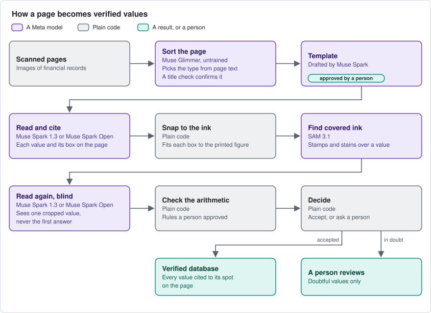
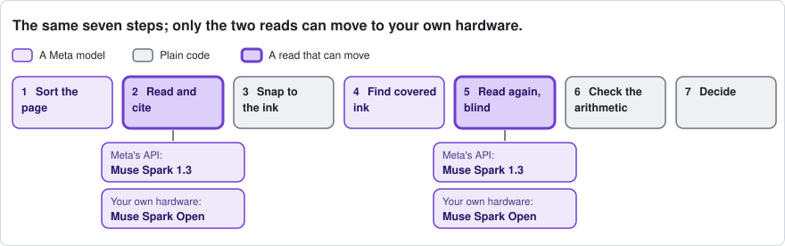
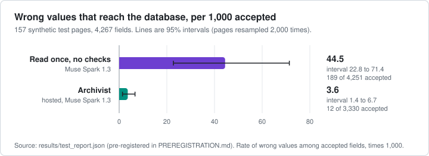
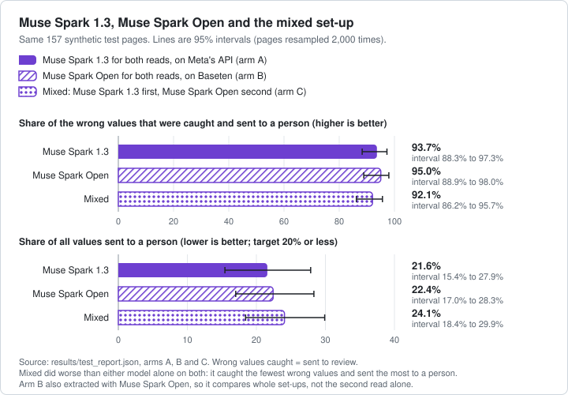
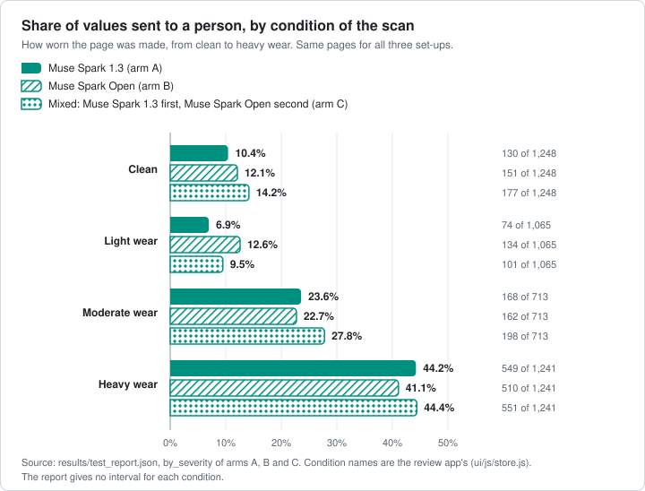

# Archivist

<!-- Logo goes here: assets/brand/ (added later). -->

Archivist turns scanned financial archives into a verified database. Every value is cited to its spot on the page, cross-checked by arithmetic and a blind second read, and flagged for a person when unsure.

## For judges

**The problem.** *(Draft: for the author to rewrite.)* Banks hold decades of records as scans. Typing them in is slow, and a model reading them alone gets some values wrong without saying which.

**Headline.** On a pre-registered test (targets set in git first) of 157 synthetic pages, a single read let in about 45 wrong values per 1,000. Archivist let in about 4 and sent about 1 in 5 values to a person. Three of five targets were met. Real scans: [results pending].

**Meta models.** Muse Glimmer (Modal GPUs) sorts pages; Muse Spark 1.3 and SAM 3.1 (Meta's API) read and find covered ink; Muse Spark Open (open weights, Baseten) can replace Muse Spark 1.3.

**Live demo:** [link pending] · **Video:** [link pending]

> No model grades its own work. Every value gets a blind second read and plain-code arithmetic, and a person decides anything in doubt.

## How it works

Seven steps; a value is accepted only when independent checks agree.



1. **Sort the page.** Muse Glimmer, untrained, picks the table type from the page's text; a plain-code title check confirms it. Each real-archive table type has a template, a description of its layout, drafted by Muse Spark and approved by a person.
2. **Read and cite.** A model reads every value and boxes where it saw it.
3. **Snap to the ink.** Plain code fits each box to the printed figure, using the archive's text layer or ruled lines.
4. **Find covered ink.** SAM 3.1, a Meta model that outlines objects in an image, looks for stamps and stains over values.
5. **Read again, blind.** A model re-reads each value from a small crop, never seeing the first answer.
6. **Check the arithmetic.** Plain code tests rules a person approved, such as totals that must add up.
7. **Decide.** A value is accepted only if both reads agree and every rule holds; otherwise a person decides.

Step 1 is being wired in on branch `glimmer` (P37); the first real-scan test sorted pages with Muse Spark 1.3.

Principles:

- No model grades its own work.
- The model proposes, a person decides; values are never changed.
- Source errors are flagged, never corrected.
- Every decision is recorded and replays exactly.
- Only synthetic or public-domain pages reach a model.

## One scheme, one swap

Muse Spark Open, a model whose trained weights are published, can replace Muse Spark 1.3 for both reads (steps 2 and 5), so a bank that cannot send documents out can run the reading on its own machines.



- **Just as accurate on the test pages:** 0.30% wrong among accepted values against 0.36%, with overlapping ranges. The method, not one model, gives the accuracy.
- **Costlier per page:** $0.0564 against $0.0089, partly because hosted calls ran at the hackathon's Contributor discount.
- **Not yet proven on-site.** No measured run has kept a page on a bank's own machines: Muse Spark Open ran on Baseten and SAM 3.1 still used Meta's API.
- **Measured so far:** the synthetic test on both; real Treasury pages on Meta's API (scores [pending]). Open weights are not measured on real scans yet, apart from cost, speed and empty answers on development pages.

<details>
<summary>The four Meta models: exact ids, hosts, jobs, and what each report found</summary>

| Model | Exact id (file) | Host | Job | What was found |
|---|---|---|---|---|
| Muse Glimmer | `meta-models/Muse-Glimmer-30B@a4e59da52a7bc87ae7251dd5545c0dd437c44b68` (branch `glimmer`, `results/glimmer/baseline_roles.toml`; not in `config/` yet) | Modal GPUs | Untrained, picks the table type from the page's text (step 1) | Phase 2 (791 unseen pages): see Results, "Sorting pages". It still named a table type for 78 of the 155 pages the title check rejected, so the title check stays. Report [`results/glimmer/phase2/REPORT.md`](https://github.com/kamil-shirinov/Archivist/blob/glimmer/results/glimmer/phase2/REPORT.md). Phase 1 (40 development pages, scored against Muse Spark's own confirmed answers): untrained 39 of 40; fine-tuned 0 of 40 under the frozen parser and 40 of 40 under a diagnostic added afterwards, which is not a pre-registered claim; report [`results/glimmer/REPORT.md`](https://github.com/kamil-shirinov/Archivist/blob/glimmer/results/glimmer/REPORT.md). |
| Muse Spark 1.3 | `muse-spark-1.3-contributor` (`config/models.toml`) | Meta Model API | Reads and cites, re-reads blind, drafts templates; sorted pages in the version 1 real-scan test | A one-value re-read costs $0.00011; the open model's costs about 25 times as much. |
| Muse Spark Open | `meta-models/muse-spark-open-1026` (`config/models_open.toml`) | Baseten | Replaces Muse Spark 1.3 for both reads | Takes "low" reasoning but does not honour "minimal". 5 of 200 re-reads came back empty (2.5%). $0.0028 a re-read, 2.1 a second at 8 at once. The report's pick of host. A second host, Fireworks (`accounts/fireworks/models/muse-spark-open`, `config/models_fireworks.toml`), was tried and dropped: 3 of 200 re-reads empty, "can't read" for 103 of 200 crops (51.5%) against 8 of 200 on Baseten, 0.39 re-reads a second. |
| SAM 3.1 | `sam-3.1` (every config) | Meta Model API | Finds covered ink (step 4) | Not measured in the open-weights report. It stayed on Meta's API in the open-weights arm. |

The open-weights report is [`results/openw_measure/REPORT.md`](https://github.com/kamil-shirinov/Archivist/blob/openw-measure/results/openw_measure/REPORT.md) on branch `openw-measure` (commit `633cdff`, not merged). It used development pages only and made no call to Meta's API. It also found that on development pages of real scans Muse Spark Open's own boxes sit away from the printed figures, so the box step anchors fewer cells and most re-read crops come from the wrong place (section 4.5).

</details>

## Results

Archivist met three of five pre-registered targets on the synthetic test. Sources are listed at the end.

| | Target | Result (95% interval: the middle 95% of the rate on 2,000 resamples of the test pages) | Verdict |
|---|---|---|---|
| H1 | Wrong values among those accepted: lower than reading once, intervals not overlapping | 0.36% (0.14% to 0.67%) against 4.45% (2.28% to 7.14%) | Met |
| H2 | Catches at least 85% of wrong values | 93.65% (88.31% to 97.28%): 177 of 189 | Met |
| H3 | Sends at most 20% of values to a person | 21.58% (15.44% to 27.87%): 921 of 4,267 | **Missed** |
| H4 | All-open-weights arm: under 1% wrong among accepted | 0.30% (0.12% to 0.54%): 10 of 3,296 | Met |
| H5 | Flags at least 90% of the planted source errors | 88.46%: 23 of 26 (the report gives no interval) | **Missed** |





Mixing the two models (Muse Spark 1.3 first, Muse Spark Open second) did worse on both wrong values and review, so Archivist never mixes them in one run.



A [script](docs/make_charts.py) draws the charts from the test report and fails if they drift.

**Sorting pages.** Measured against the pipeline's own decisions, not human truth: on 791 held-out pages (never seen while the system was built), untrained Muse Glimmer found all 136 confirmed table pages and called 495 of 500 sampled other pages "other". The fine-tuned version missed 19 table pages, including all 10 total-claims pages, so Archivist uses the untrained one. A 50-page human check is still to do.

**Real-scan test** ([plan](PREREGISTRATION_REAL.md)). The sweep sorted all 4,569 held-out Treasury Bulletin pages into five approved table types, and the title check confirmed 136 of the 291 the model assigned. The deep check ran on 58 of them: 33,114 table cells and 29,018 blind re-reads. The answer key is 400 cells drawn in advance and labelled by the author from the printed page, never shown a model's figure; 40 are labelled again a day or more later. The scorer runs once the labels are committed, on the tagged code.

- [real-scan results, version 1, hosted: pending]
- [real-scan results, open weights: pending]
- [version 2: pending]

## Why it's built this way

- **Every value is read twice, once blind,** because in development one misread debit was carried through every later balance, so arithmetic alone passed it.
- **The arithmetic is plain code,** so it shares none of a model's blind spots.
- **Tests use held-out pages,** so a score cannot be tuned.
- **The answer key is hand-labelled,** because only a person reading the printed page can say what is true on a real scan.
- **Only synthetic or public-domain pages reach a model,** because free-credit API traffic may be used by Meta for product improvement.
- **One scheme, one swap,** so accuracy belongs to the method and a bank can choose where its pages go ([above](#one-scheme-one-swap)).

## Tried and dropped

| Tried | Why it was dropped | Evidence |
|---|---|---|
| Fine-tuned Muse Glimmer for sorting | Missed 19 of 136 table pages on 791 unseen pages, including all 10 total-claims pages | Glimmer phase 2 report, branch `glimmer` |
| Mixing the two models between reads (arm C) | Worse than either model alone on wrong values accepted (4.7 per 1,000 against 3.6 and 3.0) and on values sent to a person (24.1% against 21.6% and 22.4%) | `results/test_report.json`, arms A, B and C |
| A second look before raising an alarm (policy v3) | Cut review by about a third but missed more errors, and its proposed corrections were mostly wrong | `DECISIONS.md` D29; `results/arms_compare.json` |
| Fireworks as a second host for Muse Spark Open | Page reads 4 to 13 times slower than Baseten (one never returned in 30 minutes), re-reads about a fifth as fast, and "can't read" for half the crops | Open-weights report, sections 4, 5 and 10, branch `openw-measure` |

## Proof and dates

Each plan was committed before the runs it governs. Dates are from `git log`, set by the committer's clock, not a third-party timestamp.

<details>
<summary>Pre-registrations beside the commits they govern</summary>

| Registered | Commit or tag | Date (UTC) | Governs | Commits that follow |
|---|---|---|---|---|
| Synthetic test set and plan (`PREREGISTRATION.md`; manifest sha256 `78db32f3…`) | `fc85fce` | 2026-10-27 07:45 | 157 pages, four configurations | Baseline `a5375ae` 07:58; arm A `6240efd` 09:34; arm C `e7b728f` 12:15; arm B `b330c12` 14:47; report `5297b60` 15:03. The code it froze: `63d7d5e`, 00:37 the same day. |
| Real-pages plan (`PREREGISTRATION_REAL.md`), tag `prereg-real-treasury` | `c69d24a` | 2026-10-29 08:02 | Held-out Treasury issues | Title check and runner `462828d`, `b8ff15d` |
| Runner code, tag `run-real-treasury` | `b8ff15d` | 2026-10-29 08:41 | The held-out run | Sweep began 08:49:35 and the deep check finished 23:55:06 (`results/real_test/held_out/`); records `00da8e1`, 23:59 |
| Draw of the 400 values to label | `6d35bae` | 2026-10-30 00:00 | The answer key | `labels/draw.json` |
| Scorer, tested on synthetic records only | `b934786` | 2026-10-30 07:26 | The scoring | Weights decision recorded `f1d3091`, 07:38, before any scoring |
| Real-scan score | [pending] | [pending] | | |

The tags are lightweight, so git stores the tagged commit's date, not when the tag was made; the run's own timestamps (`sweep.json`) show it began after the tagged commit. Both plans have changed only below their Deviations heading (checked 2026-10-31).

</details>

The first commit is `dd55660`, 2026-10-26 16:06 UTC; none comes before it. Everything here was built from 26 Oct 2026, except the third-party components in Credits.

## Honest limits

- **Two targets missed:** 21.58% of values went to a person (limit 20%); 23 of 26 planted source errors were flagged, 88.46% (target 90%).
- **One run:** 157 pages from 12 accounts that share names and amounts, so the intervals may understate the uncertainty.
- **Boxes can sit away from the printed value on pages where section headings repeat.** [box-offset measurement: not yet in a committed file]
- **The templates drifted on the wartime layout.** Drafted from 1939 pages, they met later issues: 39 of 58 deep-check pages print different columns (all from April 1940 on), 18 match (one only as far as its text layer reaches) and one is a different table.
- **One page passed the title check wrongly:** a table of revisions to security transactions, whose title contains the approved one.
- **Hosted costs use the Contributor discount** (see above).
- **One labeller, familiar tables:** the author alone labels the real-scan key, and the test covers later issues of tables the system was built from, not unseen archives.

## Run it yourself

Needs Python 3.12 and [uv](https://docs.astral.sh/uv/).

```bash
uv sync --frozen
```

```bash
uv run pytest -q && uv run python -m archivist.replay
```

That second command is the Check. The saved model answers are not committed, so the replay stops at the missing cache. Without the Treasury scans, three export tests also fail (3 failed, 1,379 passed, 1 skipped on 2026-10-31).

| With no key and no model call, run | What it shows |
|---|---|
| `uv run python -m archivist.eval.test_report` | Rewrites `results/test_report.json` and `results/TEST_RESULTS.md` unchanged in a clean checkout (24 seconds, 2026-10-31) |
| `uv run python -m archivist.export.bundle --run test-archivist-A --check` | A committed export matches its run |
| `uv run python docs/make_charts.py --check` | The charts match the report |

Not reproducible here: the model calls (they need a key and spend) and the held-out real-page run, which ran once on the tagged code; its scans come from FRASER and are not committed.

For the demo, a local app reads a page with real model calls, each visible as it happens, on your machine only.

```bash
uv run python -m archivist.live
```

Open the address it prints and choose **Read a page**. **Live calls** needs `META_API_KEY` (and `BASETEN_API_KEY` for open-weight choices); **Replay** spends nothing. Only development pages are offered. [Details](docs/live-reading.md).

## What's next

A learning loop, not built yet: people correct values in the review queue and the corrections are kept; a new version is trained on them, measured on held-back pages and approved by a person first. Today a reviewer's answers stay in their own browser.

<details>
<summary>Where the numbers come from</summary>

| Numbers | Source |
|---|---|
| Test results, charts, per-page costs | [`results/test_report.json`](results/test_report.json), [`results/TEST_RESULTS.md`](results/TEST_RESULTS.md); plan [`PREREGISTRATION.md`](PREREGISTRATION.md) |
| Real-scan test counts (4,569 pages in 46 issues: every month of 1940 to 1942 and each June of 1985 to 1994) | `results/real_test/held_out/sweep.json`, `run.json`, `labels/draw.json`; plan `PREREGISTRATION_REAL.md`; tag `run-real-treasury` |
| Layout drift, title-check page (the results will score the drifted cells both ways, and name the title-check page as a weakness) | `PREREGISTRATION_REAL.md` (Deviations); `results/real_test/held_out/layout_check.md` |
| Prices ($0.10 in and $0.20 out per million tokens for Contributor mode; $1.25 and $4.25 at the standard price) | `config/models.toml` (decision D19) |
| Open-weights findings | `results/openw_measure/REPORT.md` on branch `openw-measure` |
| Sorting results | `results/glimmer/phase2/REPORT.md` on branch `glimmer` (commit `a867f4d`) |
| Why it is built this way | `DECISIONS.md`: D4, D7, D10, D14, D24, D25, D26, D30 |
| Dates and commits | `git log` (see Proof and dates) |

</details>

<details>
<summary>Credits</summary>

**Fonts.** Rendering synthetic documents: Libre Baskerville, Courier Prime and Nanum Pen Script (SIL Open Font License 1.1); Special Elite and Homemade Apple (Apache License 2.0). Licence files are in `assets/fonts/`. The review app uses Geist (SIL Open Font License 1.1, `ui/fonts/GEIST-OFL.txt`). Sources and dates: [`DATA_SOURCES.md`](DATA_SOURCES.md).

**Libraries** (`pyproject.toml`): faker, meta-sam-parser, numpy, openai (the SDK that calls the APIs), pillow, pydantic, pypdfium2, python-dotenv, pyyaml; for development jsonschema, pre-commit and pytest. Python 3.12, locked with uv.

**Data.** All from FRASER, the St. Louis Fed's archive; PDFs are not committed, and per-file records are in each source's `sources.json`.

| Source | Rights statement |
|---|---|
| Treasury Bulletin, 1939 to 1942 and June 1982 to 1994 | FRASER's statement for the title: "No Copyright - United States" |
| Annual Report of the Comptroller of the Currency, 1905 to 1940 | FRASER shows none. Recorded basis: works of the US Government (17 U.S.C. § 105), and public domain by age for 1905 to 1930 |
| Federal Reserve Bulletin, June issues 1980 to 2003 | FRASER's title-page statement "No Copyright - United States", plus the Board's standing as a federal agency (17 U.S.C. § 105). Not checked: material credited to someone outside the Board |

No real bank or customer data is used.

**Models.** No model licence text is stored in this repository, so none is stated here. The Fireworks listing quoted in `src/archivist/models/fireworks_api.py` describes Muse Spark Open as an open-weights reasoning model with 816B total and 42B active parameters. [model licences: to be confirmed from Meta's pages]

</details>
