# Box strategy for template tables, measured on development pages

Made by `python -m archivist.templates.compare_citations`. A measurement, reported whatever it shows. The pages are those each draft in `templates/` was drafted from, all on the development side of `data/real/split.json`. On each page, up to 40 cells that the draft's identities need and that were read as a figure the first time are drawn with `random.Random(2110)`, and each is re-read blind from a crop of its box under both strategies: **S0**, the model's own box, and **S0+ink**, the same box corrected from the image (D23, chosen on synthetic ledger cards). The measure is the share of sampled cells whose two reads agree, as the draft compares them; a failed or illegible re-read does not agree. Every sampled cell, with both reads, is in `results/templates/citations_dev.json`.

Rule, fixed before running: the strategy with the higher share over all sampled cells becomes the template types' strategy; on a tie, the simpler (S0). The ledger card and payment memo keep S0+ink, so no committed run changes.

Config: `{"drafter": {"backend": "meta", "model_id": "muse-spark-1.3-contributor"}, "extractor": {"backend": "meta", "model_id": "muse-spark-1.3-contributor"}, "rereader": {"backend": "meta", "model_id": "muse-spark-1.3-contributor"}}`

## Result

| Strategy | Cells agreeing | Share |
|---|--:|--:|
| S0 | 206 / 720 | 28.6% |
| S0+ink | 181 / 720 | 25.1% |

**Chosen for templates by the rule: S0.**

## Why cells disagree, by rule

Every disagreement, by the rule's cause (the module docstring defines them; "neighbouring cell" does not tell a box offset from a misplaced first read), except that a cell whose every re-read attempt ran out of tokens is "re-read out of tokens", not an unreadable crop (see Long re-reads).

| Strategy | Disagree | re-read out of tokens | unreadable crop | formatting only | neighbouring cell | unexplained |
|---|--:|--:|--:|--:|--:|--:|
| S0 | 514 | 41 (8%) | 87 (17%) | 6 (1%) | 164 (32%) | 216 (42%) |
| S0+ink | 539 | 37 (7%) | 79 (15%) | 1 (0%) | 110 (20%) | 312 (58%) |

## Long re-reads

Every cached answer to a sampled cell's re-read (first attempt, and the retry asked when it did not parse). Output tokens include the reasoning; the limit is 2048. An answer that reaches it is cut off; an empty or cut answer does not parse, so the re-read is asked once more, and when that fails too the cell has no second read (counted as not agreeing; its cause is "re-read out of tokens"). Answer text: the JSON that came back, whose length shows whether the answer itself ran long (over 200 tokens is about 800 characters).

| Strategy | Answers | Median tokens | Over 200 tokens | At the limit (empty) | Answer text over 800 chars | Cells with an answer at the limit, counted as |
|---|--:|--:|--:|--:|--:|---|
| S0 | 808 | 758 | 803 | 129 (129) | 0 | no second read 43, disagree 32, agree 13 |
| S0+ink | 807 | 771 | 802 | 124 (123) | 0 | disagree 38, no second read 37, agree 12 |

What some of them say:

- S0+ink, 1939-01_p051 row 29, france, first attempt, 2048 tokens: `{"value": "2` (first read `2,989`; counted as no second read)
- S0, 1939-02_p029 row 02, tobacco, first attempt, 2048 tokens: *(empty)* (first read `434,445`; counted as disagree)
- S0, 1939-02_p029 row 03, alcoholic, first attempt, 2048 tokens: *(empty)* (first read `11,695`; counted as no second read)
- S0, 1939-12_p018 row 28, payroll_total, first attempt, 1960 tokens: `{"value": "Club dues and initiation fees..........."}` (first read `Oleomargarine, including special taxes...`; counted as disagree)
- S0+ink, 1939-12_p018 row 24, payroll_total, first attempt, 737 tokens: `{"value": "Adulterated and process"}` (first read `Leases of safe-deposit boxes...`; counted as disagree)
- S0+ink, 1939-12_p018 row 17, payroll_total, retry attempt, 1367 tokens: `{"value": "Miscellaneous taxes:"}` (first read `Cameras and lenses (repealed as of 7/1/38).`; counted as disagree)

## Is the table's grid findable from the page alone?

Measured separately, in plain image code on the same pages: `results/templates/grid_dev.md` (`python -m archivist.templates.grid_probe`).

## By page

Shift: the median vertical move of a sampled box's centre from S0 to S0+ink, in pixels (down is positive), with the page's height.

| Family | Page | Sampled | S0 agree | S0+ink agree | Shift (px) | No second read (S0 / S0+ink) |
|---|---|--:|--:|--:|--:|--:|
| `collections_of_internal_revenue` | 1939-02_p029 | 40 | 3 (8%) | 0 (0%) | +61 of 2112 | 8 / 7 |
| `collections_of_internal_revenue` | 1939-07_p023 | 40 | 3 (8%) | 17 (42%) | -27 of 2150 | 3 / 2 |
| `collections_of_internal_revenue` | 1939-12_p018 | 40 | 4 (10%) | 3 (8%) | +110 of 2103 | 2 / 2 |
| `outstanding_forward_exchange_contracts` | 1939-01_p061 | 40 | 32 (80%) | 27 (68%) | -5 of 2120 | 0 / 5 |
| `outstanding_forward_exchange_contracts` | 1939-07_p085 | 40 | 33 (82%) | 0 (0%) | -483 of 2150 | 0 / 0 |
| `outstanding_forward_exchange_contracts` | 1939-12_p060 | 40 | 22 (55%) | 22 (55%) | -3 of 2103 | 1 / 4 |
| `security_transactions_as_reported_by` | 1939-01_p055 | 40 | 27 (68%) | 19 (48%) | -0 of 2120 | 3 / 4 |
| `security_transactions_as_reported_by` | 1939-07_p075 | 40 | 8 (20%) | 28 (70%) | -25 of 2150 | 1 / 0 |
| `security_transactions_as_reported_by` | 1939-12_p055 | 40 | 18 (45%) | 19 (48%) | +0 of 2120 | 1 / 2 |
| `short_term_foreign_liabilities_as` | 1939-01_p051 | 40 | 17 (42%) | 11 (28%) | +14 of 2120 | 3 / 4 |
| `short_term_foreign_liabilities_as` | 1939-07_p071 | 40 | 12 (30%) | 0 (0%) | +316 of 2150 | 7 / 6 |
| `short_term_foreign_liabilities_as` | 1939-12_p053 | 40 | 13 (32%) | 11 (28%) | +14 of 2120 | 1 / 2 |
| `total_claims_by_country` | 1982-06_p094 | 40 | 2 (5%) | 8 (20%) | -17 of 2237 | 2 / 0 |
| `total_claims_by_country` | 1983-06_p092 | 40 | 1 (2%) | 0 (0%) | -177 of 2067 | 3 / 1 |
| `total_claims_by_country` | 1984-06_p058 | 40 | 0 (0%) | 8 (20%) | +17 of 1575 | 2 / 0 |
| `total_liabilities_by_country` | 1982-06_p091 | 40 | 1 (2%) | 0 (0%) | -114 of 2237 | 7 / 2 |
| `total_liabilities_by_country` | 1983-06_p097 | 40 | 6 (15%) | 3 (8%) | -60 of 2053 | 2 / 0 |
| `total_liabilities_by_country` | 1984-06_p055 | 40 | 4 (10%) | 5 (12%) | -145 of 1559 | 5 / 3 |

## By family

| Family | Sampled | S0 | S0+ink |
|---|--:|--:|--:|
| `collections_of_internal_revenue` | 120 | 10 (8%) | 20 (17%) |
| `outstanding_forward_exchange_contracts` | 120 | 87 (72%) | 49 (41%) |
| `security_transactions_as_reported_by` | 120 | 53 (44%) | 66 (55%) |
| `short_term_foreign_liabilities_as` | 120 | 42 (35%) | 22 (18%) |
| `total_claims_by_country` | 120 | 3 (2%) | 16 (13%) |
| `total_liabilities_by_country` | 120 | 11 (9%) | 8 (7%) |

## 20 disagreements under S0, looked at

Drawn with `random.Random(2110)` from the 514 disagreements. Crop: what the re-reader saw. Context: the page around it, the box in red and the crop in blue. Judged: a reviewer's reading of the context strip and of the first read's row labels, where given; by Claude, in `results/templates/citations_dev_causes.json`: box offset 16, re-read wrong 2, unclear 1, formatting only 1

| # | Page, cell | Crop | First read | Re-read | By rule | Judged | Context |
|--:|---|---|---|---|---|---|---|
| 1 | 1939-02_p029 `collections_of_internal_revenue` row 03, title_ix |  | `-` | *(blank)* | unreadable crop | box offset: the box sits between two columns of dashes; the crop shows only the edge of one | [strip](citations_dev/S0_01_context.png) |
| 2 | 1939-02_p029 `collections_of_internal_revenue` row 19, individual | 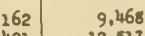 | `12,764` | `9,468` | neighbouring cell | box offset: the value is the Aug line's; the box is two printed lines lower, on Oct | [strip](citations_dev/S0_02_context.png) |
| 3 | 1939-07_p023 `collections_of_internal_revenue` row 24, corporation | 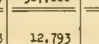 | `567,979` | `12.793` | unexplained | unclear: a two-panel page the draft reads as one table: the column does not hold this figure | [strip](citations_dev/S0_03_context.png) |
| 4 | 1939-01_p061 `outstanding_forward_exchange_contracts` row 02, canada | 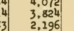 | `3,824` | `3,826` | unexplained | re-read wrong: the crop shows 3,824; the re-reader read the 4 as 6 | [strip](citations_dev/S0_04_context.png) |
| 5 | 1939-01_p061 `outstanding_forward_exchange_contracts` row 03, total_europe | 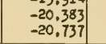 | `-20,383` | `-20,583` | unexplained | re-read wrong: the crop shows -20,383; the re-reader read the 3 as 5 | [strip](citations_dev/S0_05_context.png) |
| 6 | 1939-07_p085 `outstanding_forward_exchange_contracts` row 02, italy | 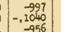 | `-,1040` | `-1,040` | formatting only | formatting only: the first read wrote "-,1040" for the printed -1,040 | [strip](citations_dev/S0_06_context.png) |
| 7 | 1939-07_p075 `security_transactions_as_reported_by` row 36, united_kingdom |  | `2,795` | `2,764` | neighbouring cell | box offset: the value is Apr. 26's; the box is one line lower, on May 3 | [strip](citations_dev/S0_07_context.png) |
| 8 | 1939-07_p075 `security_transactions_as_reported_by` row 43, canada |  | `828` | `60,266` | neighbouring cell | box offset: the value is Apr. 26's; the box is two lines lower | [strip](citations_dev/S0_08_context.png) |
| 9 | 1939-07_p075 `security_transactions_as_reported_by` row 52, far_east |  | `34` | *(blank)* | unreadable crop | box offset: the box is below the May 3 line, in the blank before the next section | [strip](citations_dev/S0_09_context.png) |
| 10 | 1939-07_p075 `security_transactions_as_reported_by` row 59, france |  | `-` | `57` | unexplained | box offset: the box is two lines low, in the next section's first line | [strip](citations_dev/S0_10_context.png) |
| 11 | 1939-01_p051 `short_term_foreign_liabilities_as` row 49, italy |  | `94` | `4894` | unreadable crop | box offset: the box is half a line low; the crop takes in two lines, 48 and 94 | [strip](citations_dev/S0_11_context.png) |
| 12 | 1983-06_p092 `total_claims_by_country` row trinidad_tobago, c2 |  | `101` | `1,813` | unexplained | box offset: the box is rows below Trinidad and Tobago, on Other Latin America | [strip](citations_dev/S0_12_context.png) |
| 13 | 1984-06_p058 `total_claims_by_country` row african_regional, c4 |  | `-` | `404,274` | unexplained | box offset: the box is several rows above African regional, on Total foreign countries | [strip](citations_dev/S0_13_context.png) |
| 14 | 1984-06_p058 `total_claims_by_country` row other_europe, c2 | 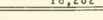 | `300` | `10,205` | unexplained | box offset: the box is two rows low, on Canada | [strip](citations_dev/S0_14_context.png) |
| 15 | 1982-06_p091 `total_liabilities_by_country` row pakistan, c4 |  | `491` | *(none)* | unreadable crop | box offset: the box is rows below Pakistan, on Thailand, where the print is also faint | [strip](citations_dev/S0_15_context.png) |
| 16 | 1982-06_p091 `total_liabilities_by_country` row south_africa, c8 |  | `329` | `,29` | unreadable crop | box offset: the box is rows below South Africa, on Total Africa, where the print is faint | [strip](citations_dev/S0_16_context.png) |
| 17 | 1984-06_p055 `total_liabilities_by_country` row singapore, c4 |  | `6,457` | *(blank)* | unreadable crop | box offset: the box is below Singapore's section, in the blank before Africa | [strip](citations_dev/S0_17_context.png) |
| 18 | 1984-06_p055 `total_liabilities_by_country` row south_africa, c6 | 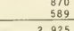 | `490` | `935` | unexplained | box offset: the box is three rows below South Africa | [strip](citations_dev/S0_18_context.png) |
| 19 | 1984-06_p055 `total_liabilities_by_country` row total_africa, c2 |  | `3,134` | `5.9` | unexplained | box offset: the box is between Total Africa and Australia; the crop catches part of 5,909 | [strip](citations_dev/S0_19_context.png) |
| 20 | 1984-06_p055 `total_liabilities_by_country` row total_europe, c1 | 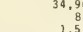 | `92,334` | `34,9` | unexplained | box offset: the box is far below Total Europe, among Latin America's rows | [strip](citations_dev/S0_20_context.png) |

## 20 disagreements under S0+ink, looked at

Drawn with `random.Random(2110)` from the 539 disagreements. Crop: what the re-reader saw. Context: the page around it, the box in red and the crop in blue. Judged: a reviewer's reading of the context strip and of the first read's row labels, where given; by Claude, in `results/templates/citations_dev_causes.json`: box offset 18, unreadable crop 2

| # | Page, cell | Crop | First read | Re-read | By rule | Judged | Context |
|--:|---|---|---|---|---|---|---|
| 1 | 1939-02_p029 `collections_of_internal_revenue` row 03, title_ix | 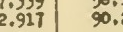 | `-` | `2.917` | unexplained | box offset: ink moved the box many lines down, to the 1937 row | [strip](citations_dev/S0_ink_01_context.png) |
| 2 | 1939-02_p029 `collections_of_internal_revenue` row 18, payroll_total |  | `77,707` | *(none)* | unreadable crop | box offset: ink moved the box down to the Dec line, between figures | [strip](citations_dev/S0_ink_02_context.png) |
| 3 | 1939-07_p085 `outstanding_forward_exchange_contracts` row 01, canada | 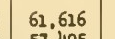 | `107` | `61,616` | unexplained | box offset: ink moved every box on the page about 480 px up, into the section above | [strip](citations_dev/S0_ink_03_context.png) |
| 4 | 1939-07_p085 `outstanding_forward_exchange_contracts` row 01, france |  | `-2,861` | `1,871` | unexplained | box offset: ink moved the box about 480 px up, into the section above | [strip](citations_dev/S0_ink_04_context.png) |
| 5 | 1939-07_p085 `outstanding_forward_exchange_contracts` row 02, canada | 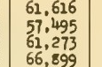 | `798` | `61,273` | unexplained | box offset: ink moved the box up and stretched it over four lines | [strip](citations_dev/S0_ink_05_context.png) |
| 6 | 1939-12_p060 `outstanding_forward_exchange_contracts` row 04, switzerland | 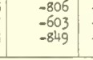 | `-849` | `-603` | neighbouring cell | box offset: ink stretched the box over two lines; the re-reader read the upper one | [strip](citations_dev/S0_ink_06_context.png) |
| 7 | 1939-01_p055 `security_transactions_as_reported_by` row 18, italy | 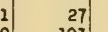 | `103` | `1` | unreadable crop | box offset: the box is one line up, on Oct. 5, and off to one side | [strip](citations_dev/S0_ink_07_context.png) |
| 8 | 1939-01_p055 `security_transactions_as_reported_by` row 50, switzerland | 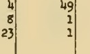 | `1` | *(none)* | re-read out of tokens | unreadable crop: ink made the box a thin strip down four lines; nothing legible in it | [strip](citations_dev/S0_ink_08_context.png) |
| 9 | 1939-01_p051 `short_term_foreign_liabilities_as` row 13, france |  | `161,572` | `160,100` | unexplained | box offset: the box is one line down, on Oct. 19 | [strip](citations_dev/S0_ink_09_context.png) |
| 10 | 1983-06_p092 `total_claims_by_country` row finland, c3 |  | `409` | `185` | neighbouring cell | box offset: the box is two rows up, on Denmark | [strip](citations_dev/S0_ink_10_context.png) |
| 11 | 1983-06_p092 `total_claims_by_country` row german_democratic_republic, c3 |  | `103` | `4,643` | neighbouring cell | box offset: the box is one row up, on France | [strip](citations_dev/S0_ink_11_context.png) |
| 12 | 1983-06_p092 `total_claims_by_country` row total_africa, c2 |  | `3,150` | `322` | unexplained | box offset: the box is in another section, on Other Asia | [strip](citations_dev/S0_ink_12_context.png) |
| 13 | 1984-06_p058 `total_claims_by_country` row trinidad_tobago, c3 |  | `155` | `2,125` | unexplained | box offset: the box is rows below, on Other Latin America | [strip](citations_dev/S0_ink_13_context.png) |
| 14 | 1982-06_p091 `total_liabilities_by_country` row china_mainland, c1 | 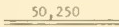 | `50` | `50,250` | unreadable crop | box offset: the box is on Total Latin America, rows above China | [strip](citations_dev/S0_ink_14_context.png) |
| 15 | 1983-06_p097 `total_liabilities_by_country` row taiwan, c5 |  | `216` | `3/4` | unexplained | box offset: the box is rows above Taiwan, among Latin America's rows | [strip](citations_dev/S0_ink_15_context.png) |
| 16 | 1983-06_p097 `total_liabilities_by_country` row taiwan, c6 |  | `191` | `291` | unexplained | box offset: the box is rows above Taiwan, among Latin America's rows | [strip](citations_dev/S0_ink_16_context.png) |
| 17 | 1984-06_p055 `total_liabilities_by_country` row african_regional, c4 | 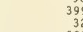 | `1` | `32` | unexplained | box offset: ink moved the box about 200 px up, to South Africa | [strip](citations_dev/S0_ink_17_context.png) |
| 18 | 1984-06_p055 `total_liabilities_by_country` row belgium_luxembourg, c8 |  | `3,901` | `18` | neighbouring cell | unreadable crop: ink shrank the box to a 12 x 9 px fragment of the cell | [strip](citations_dev/S0_ink_18_context.png) |
| 19 | 1984-06_p055 `total_liabilities_by_country` row middle_eastern_regional, c3 |  | `48` | `8` | unreadable crop | box offset: the box is on Zaire, rows above Middle Eastern regional | [strip](citations_dev/S0_ink_19_context.png) |
| 20 | 1984-06_p055 `total_liabilities_by_country` row trinidad_tobago, c3 |  | `139` | `1,168` | neighbouring cell | box offset: the box is one row up, on Peru | [strip](citations_dev/S0_ink_20_context.png) |
