# Box strategy for template tables, measured on development pages

Made by `python -m archivist.templates.compare_citations`. A measurement, reported whatever it shows. The pages are those each draft in `templates/` was drafted from, all on the development side of `data/real/split.json`. On each page, up to 40 cells that the draft's identities need and that were read as a figure the first time are drawn with `random.Random(2110)`, and each is re-read blind from a crop of its box under both strategies: **S0**, the model's own box, and **S0+ocr**, the box of the same figure in the archive's own OCR text layer where it is found with confidence (near the model's box, in its row region and column; `ocr.py`), else the model's box, unanchored. The re-reader runs at reasoning "minimal" (templates only). The measure is the share of sampled cells whose two reads agree, as the draft compares them; a failed or illegible re-read does not agree. Every sampled cell, with both reads, is in `results/templates/citations_dev_v2.json`. The first measurement, S0 against S0+ink with the re-reader at "low", is kept as written in `results/templates/citations_dev.md`; the sample is the same.

Rule, fixed before running: the strategy with the higher share over all sampled cells becomes the template types' strategy; on a tie, the simpler (S0). The ledger card and payment memo keep S0+ink, so no committed run changes.

Config: `{"drafter": {"backend": "meta", "model_id": "muse-spark-1.3-contributor"}, "extractor": {"backend": "meta", "model_id": "muse-spark-1.3-contributor"}, "rereader": {"backend": "meta", "model_id": "muse-spark-1.3-contributor"}}`

## Result

| Strategy | Cells agreeing | Share |
|---|--:|--:|
| S0 | 250 / 720 | 34.7% |
| S0+ocr | 376 / 720 | 52.2% |

**Chosen for templates by the rule: S0+ocr.**

## Anchored to the OCR layer

Of the 8007 figure cells the sample is drawn from, S0+ocr anchored 2943 (37%); of the sampled cells, 254 of 720. Agreement among the sampled cells, by whether S0+ocr anchored them (an unanchored cell keeps the model's box, so its S0+ocr crop is its S0 crop):

| Sampled cells | Count | S0 agree | S0+ocr agree |
|---|--:|--:|--:|
| anchored | 254 | 91 (36%) | 217 (85%) |
| unanchored | 466 | 159 (34%) | 159 (34%) |

## Why cells disagree, by rule

Every disagreement, by the rule's cause (the module docstring defines them; "neighbouring cell" does not tell a box offset from a misplaced first read), except that a cell whose every re-read attempt ran out of tokens is "re-read out of tokens", not an unreadable crop (see Long re-reads).

| Strategy | Disagree | re-read out of tokens | unreadable crop | formatting only | neighbouring cell | unexplained |
|---|--:|--:|--:|--:|--:|--:|
| S0 | 470 | 0 (0%) | 100 (21%) | 4 (1%) | 166 (35%) | 200 (43%) |
| S0+ocr | 344 | 0 (0%) | 98 (28%) | 7 (2%) | 84 (24%) | 155 (45%) |

## Long re-reads

Every cached answer to a sampled cell's re-read (first attempt, and the retry asked when it did not parse). Output tokens include the reasoning; the limit is 2048. An answer that reaches it is cut off; an empty or cut answer does not parse, so the re-read is asked once more, and when that fails too the cell has no second read (counted as not agreeing; its cause is "re-read out of tokens"). Answer text: the JSON that came back, whose length shows whether the answer itself ran long (over 200 tokens is about 800 characters).

| Strategy | Answers | Median tokens | Over 200 tokens | At the limit (empty) | Answer text over 800 chars | Cells with an answer at the limit, counted as |
|---|--:|--:|--:|--:|--:|---|
| S0 | 721 | 293 | 545 | 1 (1) | 0 | agree 1 |
| S0+ocr | 721 | 227 | 438 | 1 (1) | 0 | agree 1 |

What some of them say:

- S0, 1939-01_p055 row 59, italy, first attempt, 2048 tokens: *(empty)* (first read `-`; counted as agree)
- S0+ocr, 1939-01_p055 row 59, italy, first attempt, 2048 tokens: *(empty)* (first read `-`; counted as agree)
- S0, 1939-07_p071 row 06, total_europe, first attempt, 266 tokens: `{"value": "1,689,410"}` (first read `1,629,410`; counted as disagree)
- S0, 1939-07_p071 row 17, total_europe, first attempt, 348 tokens: `{"value": "1,490,394"}` (first read `1,468,068`; counted as disagree)
- S0+ocr, 1939-07_p071 row 06, total_europe, first attempt, 167 tokens: `{"value": "1,629,410"}` (first read `1,629,410`; counted as agree)

## Is the table's grid findable from the page alone?

Measured separately, in plain image code on the same pages: `results/templates/grid_dev.md` (`python -m archivist.templates.grid_probe`).

## By page

Anchored: the page's figure cells (those the sample is drawn from) that S0+ocr anchored to the OCR layer. Shift: the median vertical move, from S0 to S0+ocr, of the sampled anchored boxes' centres, in pixels (down is positive), with the page's height.

| Family | Page | Sampled | S0 agree | S0+ocr agree | Anchored | Shift (px) | No second read (S0 / S0+ocr) |
|---|---|--:|--:|--:|--:|--:|--:|
| `outstanding_forward_exchange_contracts` | 1939-01_p061 | 40 | 33 (82%) | 33 (82%) | 0 / 52 (0%) | +0 of 2120 | 0 / 0 |
| `outstanding_forward_exchange_contracts` | 1939-07_p085 | 40 | 30 (75%) | 30 (75%) | 0 / 65 (0%) | +0 of 2150 | 0 / 0 |
| `outstanding_forward_exchange_contracts` | 1939-12_p060 | 40 | 22 (55%) | 35 (88%) | 49 / 52 (94%) | -2 of 2103 | 0 / 0 |
| `receipts_and_expenditures_under_railroad` | 1939-08_p043 | 40 | 22 (55%) | 23 (57%) | 18 / 68 (26%) | -4 of 2142 | 3 / 3 |
| `receipts_and_expenditures_under_railroad` | 1939-10_p024 | 40 | 18 (45%) | 20 (50%) | 18 / 68 (26%) | -2 of 2081 | 1 / 1 |
| `receipts_and_expenditures_under_railroad` | 1939-12_p025 | 40 | 9 (22%) | 16 (40%) | 20 / 68 (29%) | -26 of 2109 | 0 / 1 |
| `security_transactions_as_reported_by` | 1939-01_p055 | 40 | 29 (72%) | 30 (75%) | 318 / 624 (51%) | +4 of 2120 | 0 / 0 |
| `security_transactions_as_reported_by` | 1939-07_p075 | 40 | 10 (25%) | 19 (48%) | 142 / 520 (27%) | -4 of 2150 | 0 / 0 |
| `security_transactions_as_reported_by` | 1939-12_p055 | 40 | 21 (52%) | 27 (68%) | 287 / 624 (46%) | +18 of 2120 | 0 / 0 |
| `short_term_foreign_liabilities_as` | 1939-01_p051 | 40 | 16 (40%) | 27 (68%) | 353 / 520 (68%) | +10 of 2120 | 0 / 0 |
| `short_term_foreign_liabilities_as` | 1939-07_p071 | 40 | 13 (32%) | 27 (68%) | 383 / 533 (72%) | +3 of 2150 | 1 / 1 |
| `short_term_foreign_liabilities_as` | 1939-12_p053 | 40 | 12 (30%) | 29 (72%) | 378 / 520 (73%) | +12 of 2120 | 0 / 1 |
| `total_claims_by_country` | 1982-06_p094 | 40 | 2 (5%) | 22 (55%) | 461 / 688 (67%) | -11 of 2237 | 0 / 0 |
| `total_claims_by_country` | 1983-06_p092 | 40 | 1 (2%) | 23 (57%) | 457 / 688 (66%) | -48 of 2067 | 0 / 0 |
| `total_claims_by_country` | 1984-06_p058 | 40 | 0 (0%) | 0 (0%) | 1 / 688 (0%) | +0 of 1575 | 0 / 0 |
| `total_liabilities_by_country` | 1982-06_p091 | 40 | 3 (8%) | 4 (10%) | 26 / 767 (3%) | -7 of 2237 | 5 / 5 |
| `total_liabilities_by_country` | 1983-06_p097 | 40 | 6 (15%) | 6 (15%) | 0 / 774 (0%) | +0 of 2053 | 0 / 0 |
| `total_liabilities_by_country` | 1984-06_p055 | 40 | 3 (8%) | 5 (12%) | 32 / 688 (5%) | -65 of 1559 | 5 / 5 |

## By family

| Family | Sampled | S0 | S0+ocr |
|---|--:|--:|--:|
| `outstanding_forward_exchange_contracts` | 120 | 85 (71%) | 98 (82%) |
| `receipts_and_expenditures_under_railroad` | 120 | 49 (41%) | 59 (49%) |
| `security_transactions_as_reported_by` | 120 | 60 (50%) | 76 (63%) |
| `short_term_foreign_liabilities_as` | 120 | 41 (34%) | 83 (69%) |
| `total_claims_by_country` | 120 | 3 (2%) | 45 (38%) |
| `total_liabilities_by_country` | 120 | 12 (10%) | 15 (12%) |

## 20 disagreements under S0, looked at

Drawn with `random.Random(2110)` from the 470 disagreements. Crop: what the re-reader saw. Context: the page around it, the box in red and the crop in blue. Judged: a reviewer's reading of the context strip and of the first read's row labels, where given; by Claude, in `results/templates/citations_dev_v2_causes.json`: box offset 19, formatting only 1

| # | Page, cell | Crop | First read | Re-read | By rule | Judged | Context |
|--:|---|---|---|---|---|---|---|
| 1 | 1939-01_p061 `outstanding_forward_exchange_contracts` row 01, canada | 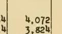 | `4,072` | `4.072` | unexplained | formatting only: the crop shows 4,072; the re-reader wrote 4.072 | [strip](citations_dev_v2/S0_01_context.png) |
| 2 | 1939-10_p024 `receipts_and_expenditures_under_railroad` row 04, to_unemployment |  | `-` | *(blank)* | unreadable crop | box offset: the box sits left of the column of dashes; the crop is empty | [strip](citations_dev_v2/S0_02_context.png) |
| 3 | 1939-10_p024 `receipts_and_expenditures_under_railroad` row 05, to_unemployment |  | `-` | `1, 1` | unexplained | box offset: the box sits left of the column of dashes; the re-reader made 1, 1 of an empty crop | [strip](citations_dev_v2/S0_03_context.png) |
| 4 | 1939-10_p024 `receipts_and_expenditures_under_railroad` row 06, to_unemployment |  | `-` | `1` | unexplained | box offset: the box sits left of the column of dashes; the re-reader made 1 of an empty crop | [strip](citations_dev_v2/S0_04_context.png) |
| 5 | 1939-12_p025 `receipts_and_expenditures_under_railroad` row 08, to_retirement | 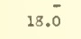 | `-` | `18.0` | neighbouring cell | box offset: the value is Feb.'s dash; the box is one line lower, on Mar.'s 18.0 | [strip](citations_dev_v2/S0_05_context.png) |
| 6 | 1939-12_p025 `receipts_and_expenditures_under_railroad` row 09, to_unemployment | 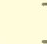 | `-` | *(blank)* | unreadable crop | box offset: the box sits between the dash column and the next; the crop is empty | [strip](citations_dev_v2/S0_06_context.png) |
| 7 | 1939-12_p025 `receipts_and_expenditures_under_railroad` row 11, to_unemployment | 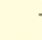 | `-` | *(blank)* | unreadable crop | box offset: the box is two lines low, beside July's 15.0, and left of the dashes | [strip](citations_dev_v2/S0_07_context.png) |
| 8 | 1939-01_p055 `security_transactions_as_reported_by` row 60, switzerland | 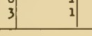 | `1` | *(blank)* | unreadable crop | box offset: the box spans two columns, 3 and 1, across a rule | [strip](citations_dev_v2/S0_08_context.png) |
| 9 | 1939-01_p051 `short_term_foreign_liabilities_as` row 35, total_europe | 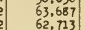 | `62,713` | `63,687` | neighbouring cell | box offset: the box straddles Oct. 19 and Oct. 26; the re-reader took the upper line | [strip](citations_dev_v2/S0_09_context.png) |
| 10 | 1939-07_p071 `short_term_foreign_liabilities_as` row 05, canada | 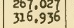 | `267,027` | `26,1,027` | unexplained | box offset: the box straddles Apr. 26 and May 3; the re-read is a garble of both | [strip](citations_dev_v2/S0_10_context.png) |
| 11 | 1939-07_p071 `short_term_foreign_liabilities_as` row 44, united_kingdom | 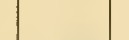 | `31,839` | *(blank)* | unreadable crop | box offset: the box is on the blank heading line above Apr. 5 | [strip](citations_dev_v2/S0_11_context.png) |
| 12 | 1939-07_p071 `short_term_foreign_liabilities_as` row 48, switzerland | 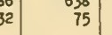 | `75` | `32` | unexplained | box offset: the box is off to the left, on the neighbouring column's 132 | [strip](citations_dev_v2/S0_12_context.png) |
| 13 | 1982-06_p094 `total_claims_by_country` row colombia, c5 |  | `1,590` | `1,390` | unexplained | box offset: the box is half a line low and cuts the faint figure; 5 read as 3 | [strip](citations_dev_v2/S0_13_context.png) |
| 14 | 1982-06_p094 `total_claims_by_country` row finland, c8 | 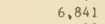 | `639` | `6,841` | neighbouring cell | box offset: the box is a line low, on France | [strip](citations_dev_v2/S0_14_context.png) |
| 15 | 1982-06_p094 `total_claims_by_country` row south_africa, c6 |  | `1,106` | `r373` | neighbouring cell | box offset: the box is two rows up, on Liberia | [strip](citations_dev_v2/S0_15_context.png) |
| 16 | 1983-06_p092 `total_claims_by_country` row total_africa, c2 |  | `3,150` | `1,344` | unexplained | box offset: the box is on Total other countries, rows below Total Africa | [strip](citations_dev_v2/S0_16_context.png) |
| 17 | 1983-06_p092 `total_claims_by_country` row total_asia, c8 |  | `64,746` | `387` | unexplained | box offset: the box is in Africa's rows, far below Total Asia | [strip](citations_dev_v2/S0_17_context.png) |
| 18 | 1983-06_p097 `total_liabilities_by_country` row latin_american_regional, c6 | 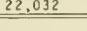 | `-` | `22,032` | unexplained | box offset: the box is on Total foreign countries, above the regional rows | [strip](citations_dev_v2/S0_18_context.png) |
| 19 | 1983-06_p097 `total_liabilities_by_country` row panama, c5 | 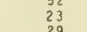 | `121` | `2` | unreadable crop | box offset: the box is a row low, on Trinidad and Tobago | [strip](citations_dev_v2/S0_19_context.png) |
| 20 | 1984-06_p055 `total_liabilities_by_country` row romania, c4 | 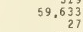 | `149` | `59,633` | unexplained | box offset: the box is rows below Romania, among Switzerland and the United Kingdom | [strip](citations_dev_v2/S0_20_context.png) |

## 20 disagreements under S0+ocr, looked at

Drawn with `random.Random(2110)` from the 344 disagreements. Crop: what the re-reader saw. Context: the page around it, the box in red and the crop in blue. Judged: a reviewer's reading of the context strip and of the first read's row labels, where given; by Claude, in `results/templates/citations_dev_v2_causes.json`: box offset 13, formatting only 3, re-read wrong 3, unreadable crop 1

| # | Page, cell | Crop | First read | Re-read | By rule | Judged | Context |
|--:|---|---|---|---|---|---|---|
| 1 | 1939-01_p061 `outstanding_forward_exchange_contracts` row 01, canada |  | `4,072` | `4.072` | unexplained | formatting only: unanchored (no OCR layer there); the crop shows 4,072; the re-reader wrote 4.072 | [strip](citations_dev_v2/S0_ocr_01_context.png) |
| 2 | 1939-07_p085 `outstanding_forward_exchange_contracts` row 04, netherlands | 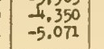 | `-4,350` | `4,350` | unexplained | re-read wrong: unanchored; the crop shows -4,350 with its minus; the re-reader dropped the minus | [strip](citations_dev_v2/S0_ocr_02_context.png) |
| 3 | 1939-10_p024 `receipts_and_expenditures_under_railroad` row 17, to_unemployment |  | `-` | *(blank)* | unreadable crop | box offset: unanchored (a dash never anchors): the model's box sits left of the dashes | [strip](citations_dev_v2/S0_ocr_03_context.png) |
| 4 | 1939-10_p024 `receipts_and_expenditures_under_railroad` row 17, total_exp | 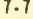 | `7.7` | *(blank)* | unreadable crop | unreadable crop: anchored to the right figure, 7.7, but the OCR word's box is 9 px tall and the crop too tight to be read | [strip](citations_dev_v2/S0_ocr_04_context.png) |
| 5 | 1939-12_p025 `receipts_and_expenditures_under_railroad` row 01, to_retirement | 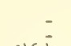 | `-` | *(blank)* | unreadable crop | formatting only: unanchored (a dash never anchors); the crop shows the nil dash, read as blank | [strip](citations_dev_v2/S0_ocr_05_context.png) |
| 6 | 1939-01_p055 `security_transactions_as_reported_by` row 38, italy | 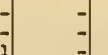 | `-` | *(blank)* | unreadable crop | box offset: unanchored (a dash never anchors): the model's box sits between columns | [strip](citations_dev_v2/S0_ocr_06_context.png) |
| 7 | 1939-01_p055 `security_transactions_as_reported_by` row 43, germany | 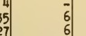 | `6` | *(blank)* | unreadable crop | box offset: unanchored (one digit never anchors): the model's box spans a rule and two columns | [strip](citations_dev_v2/S0_ocr_07_context.png) |
| 8 | 1939-07_p075 `security_transactions_as_reported_by` row 04, france | 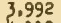 | `3,992` | `1,992` | unexplained | re-read wrong: anchored to the right figure: the crop shows 3,992; the re-reader read 1,992 | [strip](citations_dev_v2/S0_ocr_08_context.png) |
| 9 | 1939-12_p055 `security_transactions_as_reported_by` row 12, united_kingdom | 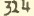 | `314` | `324` | unexplained | re-read wrong: anchored to the right figure: the crop shows 314; the re-reader read 324 | [strip](citations_dev_v2/S0_ocr_09_context.png) |
| 10 | 1983-06_p092 `total_claims_by_country` row african_regional, c4 |  | `*` | *(blank)* | unreadable crop | box offset: unanchored (an asterisk never anchors): the model's box is on Total international | [strip](citations_dev_v2/S0_ocr_10_context.png) |
| 11 | 1983-06_p092 `total_claims_by_country` row thailand, c6 | 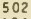 | `502` | `5 02` | formatting only | formatting only: anchored to the right figure; the re-reader wrote 5 02 | [strip](citations_dev_v2/S0_ocr_11_context.png) |
| 12 | 1984-06_p058 `total_claims_by_country` row jamaica, c2 | 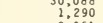 | `135` | `1,290` | neighbouring cell | box offset: unanchored (no figures in this page's OCR layer): the model's box is two rows low | [strip](citations_dev_v2/S0_ocr_12_context.png) |
| 13 | 1984-06_p058 `total_claims_by_country` row other_asia, c2 | 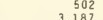 | `424` | `502` | neighbouring cell | box offset: unanchored (no figures in this page's OCR layer): the model's box is rows up, on Thailand | [strip](citations_dev_v2/S0_ocr_13_context.png) |
| 14 | 1982-06_p091 `total_liabilities_by_country` row india, c8 | 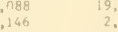 | `437` | *(none)* | unreadable crop | box offset: unanchored (no figures in this page's OCR layer): the model's box is rows up, faint print | [strip](citations_dev_v2/S0_ocr_14_context.png) |
| 15 | 1982-06_p091 `total_liabilities_by_country` row lebanon, c3 |  | `194` | `2,626` | unexplained | box offset: unanchored (no figures in this page's OCR layer): the model's box is rows below Lebanon | [strip](citations_dev_v2/S0_ocr_15_context.png) |
| 16 | 1982-06_p091 `total_liabilities_by_country` row malaysia, c3 |  | `814` | `2,626` | unexplained | box offset: unanchored (no figures in this page's OCR layer): the model's box is rows below Malaysia | [strip](citations_dev_v2/S0_ocr_16_context.png) |
| 17 | 1982-06_p091 `total_liabilities_by_country` row taiwan, c8 |  | `2,214` | `466` | unexplained | box offset: unanchored (no figures in this page's OCR layer): the model's box is rows below Taiwan | [strip](citations_dev_v2/S0_ocr_17_context.png) |
| 18 | 1984-06_p055 `total_liabilities_by_country` row asian_regional, c7 | 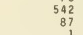 | `87` | `542` | neighbouring cell | box offset: unanchored (no figures in this page's OCR layer): the box straddles two rows | [strip](citations_dev_v2/S0_ocr_18_context.png) |
| 19 | 1984-06_p055 `total_liabilities_by_country` row china_mainland, c3 | 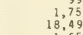 | `250` | `18,49` | unexplained | box offset: unanchored (no figures in this page's OCR layer): the model's box is rows below Mainland | [strip](citations_dev_v2/S0_ocr_19_context.png) |
| 20 | 1984-06_p055 `total_liabilities_by_country` row china_mainland, c5 |  | `250` | `18,496` | unexplained | box offset: unanchored (no figures in this page's OCR layer): the model's box is rows below Mainland | [strip](citations_dev_v2/S0_ocr_20_context.png) |
