# Box strategy for template tables, measured on development pages

Made by `python -m archivist.templates.compare_citations`. A measurement, reported whatever it shows. The pages are those each draft in `templates/` was drafted from, all on the development side of `data/real/split.json`. On each page, up to 40 cells that the draft's identities need and that were read as a figure the first time are drawn with `random.Random(2110)`, and each is re-read blind from a crop of its box under both strategies: **S0+ocr**, the box of the same figure in the archive's own OCR text layer where it is found with confidence (`ocr.py`), else the model's; and **S0+grid**, the OCR layer's box, else the cell of the table's grid found in the page by plain code (columns from the ink, rows from deskewed bands, each read row fixed by an anchored figure or its label in the OCR layer, the rows between fixed rows mapped by order only where they are as many as the bands; `grid.py`), else the model's. The re-reader runs at reasoning "minimal" (templates only). The measure is the share of sampled cells whose two reads agree, as the draft compares them; a failed or illegible re-read does not agree. Every sampled cell, with both reads, is in `results/templates/citations_dev_v3.json`. The earlier measurements are kept as written: `results/templates/citations_dev.md`, `results/templates/citations_dev_v2.md`; the sample is the same wherever the draft is.

Rule, fixed before running: the strategy with the higher share over all sampled cells becomes the template types' strategy; on a tie, the simpler (S0+ocr). The ledger card and payment memo keep S0+ink, so no committed run changes.

Config: `{"drafter": {"backend": "meta", "model_id": "muse-spark-1.3-contributor"}, "extractor": {"backend": "meta", "model_id": "muse-spark-1.3-contributor"}, "rereader": {"backend": "meta", "model_id": "muse-spark-1.3-contributor"}}`

## Result

| Strategy | Cells agreeing | Share |
|---|--:|--:|
| S0+ocr | 325 / 720 | 45.1% |
| S0+grid | 439 / 720 | 61.0% |

**Chosen for templates by the rule: S0+grid.**

## Where the boxes came from

Of the 8852 figure cells the sample is drawn from, how many boxes each strategy took from each source (ocr / grid / model):

| Strategy | ocr / grid / model |
|---|---|
| S0+ocr | 3367 (38%) / 0 (0%) / 5485 (62%) |
| S0+grid | 3367 (38%) / 3162 (36%) / 2323 (26%) |

Agreement among the sampled cells, by where each strategy's box came from:

| Strategy | Source | Sampled cells | Agree |
|---|---|--:|--:|
| S0+ocr | ocr | 277 | 230 (83%) |
| S0+ocr | model | 443 | 95 (21%) |
| S0+grid | ocr | 277 | 230 (83%) |
| S0+grid | grid | 268 | 180 (67%) |
| S0+grid | model | 175 | 29 (17%) |

## Why cells disagree, by rule

Every disagreement, by the rule's cause (the module docstring defines them; "neighbouring cell" does not tell a box offset from a misplaced first read), except that a cell whose every re-read attempt ran out of tokens is "re-read out of tokens", not an unreadable crop (see Long re-reads).

| Strategy | Disagree | re-read out of tokens | unreadable crop | formatting only | neighbouring cell | unexplained |
|---|--:|--:|--:|--:|--:|--:|
| S0+ocr | 395 | 0 (0%) | 110 (28%) | 9 (2%) | 95 (24%) | 181 (46%) |
| S0+grid | 281 | 0 (0%) | 77 (27%) | 13 (5%) | 58 (21%) | 133 (47%) |

## Long re-reads

Every cached answer to a sampled cell's re-read (first attempt, and the retry asked when it did not parse). Output tokens include the reasoning; the limit is 2048. An answer that reaches it is cut off; an empty or cut answer does not parse, so the re-read is asked once more, and when that fails too the cell has no second read (counted as not agreeing; its cause is "re-read out of tokens"). Answer text: the JSON that came back, whose length shows whether the answer itself ran long (over 200 tokens is about 800 characters).

| Strategy | Answers | Median tokens | Over 200 tokens | At the limit (empty) | Answer text over 800 chars | Cells with an answer at the limit, counted as |
|---|--:|--:|--:|--:|--:|---|
| S0+ocr | 721 | 224 | 426 | 1 (1) | 0 | agree 1 |
| S0+grid | 720 | 208 | 375 | 0 (0) | 0 | - |

What some of them say:

- S0+ocr, 1939-01_p055 row 59, italy, first attempt, 2048 tokens: *(empty)* (first read `-`; counted as agree)
- S0+grid, 1982-06_p091 row panama, c2, first attempt, 359 tokens: `{"value": "5,521\n404"}` (first read `5,521`; counted as disagree)
- S0+ocr, 1939-07_p071 row 06, total_europe, first attempt, 167 tokens: `{"value": "1,629,410"}` (first read `1,629,410`; counted as agree)
- S0+ocr, 1939-07_p071 row 17, total_europe, first attempt, 216 tokens: `{"value": "1,468,068"}` (first read `1,468,068`; counted as agree)

## Is the table's grid findable from the page alone?

Measured separately, in plain image code on the same pages: `results/templates/grid_dev.md` (`python -m archivist.templates.grid_probe`).

## By page

Boxes: where S0+grid's boxes for the page's figure cells came from, ocr / grid / model.

| Family | Page | Sampled | S0+ocr agree | S0+grid agree | S0+grid boxes (ocr / grid / model) | No second read (S0+ocr / S0+grid) |
|---|---|--:|--:|--:|---|--:|
| `outstanding_forward_exchange_contracts` | 1939-01_p061 | 40 | 18 (45%) | 24 (60%) | 221 (71%) / 91 (29%) / 0 (0%) | 1 / 0 |
| `outstanding_forward_exchange_contracts` | 1939-07_p085 | 40 | 3 (8%) | 9 (22%) | 21 (5%) / 196 (50%) / 173 (44%) | 1 / 0 |
| `outstanding_forward_exchange_contracts` | 1939-12_p060 | 40 | 26 (65%) | 29 (72%) | 231 (74%) / 52 (17%) / 29 (9%) | 0 / 0 |
| `receipts_and_expenditures_under_railroad` | 1939-08_p043 | 40 | 23 (57%) | 27 (68%) | 18 (26%) / 42 (62%) / 8 (12%) | 3 / 1 |
| `receipts_and_expenditures_under_railroad` | 1939-10_p024 | 40 | 20 (50%) | 29 (72%) | 18 (26%) / 34 (50%) / 16 (24%) | 1 / 1 |
| `receipts_and_expenditures_under_railroad` | 1939-12_p025 | 40 | 16 (40%) | 21 (52%) | 20 (29%) / 36 (53%) / 12 (18%) | 1 / 3 |
| `security_transactions_as_reported_by` | 1939-01_p055 | 40 | 30 (75%) | 25 (62%) | 318 (51%) / 306 (49%) / 0 (0%) | 0 / 1 |
| `security_transactions_as_reported_by` | 1939-07_p075 | 40 | 19 (48%) | 30 (75%) | 142 (27%) / 365 (70%) / 13 (2%) | 0 / 0 |
| `security_transactions_as_reported_by` | 1939-12_p055 | 40 | 27 (68%) | 30 (75%) | 287 (46%) / 300 (48%) / 37 (6%) | 0 / 0 |
| `short_term_foreign_liabilities_as` | 1939-01_p051 | 40 | 27 (68%) | 28 (70%) | 353 (68%) / 21 (4%) / 146 (28%) | 0 / 0 |
| `short_term_foreign_liabilities_as` | 1939-07_p071 | 40 | 27 (68%) | 28 (70%) | 383 (72%) / 61 (11%) / 89 (17%) | 1 / 1 |
| `short_term_foreign_liabilities_as` | 1939-12_p053 | 40 | 29 (72%) | 29 (72%) | 378 (73%) / 0 (0%) / 142 (27%) | 1 / 1 |
| `total_claims_by_country` | 1982-06_p094 | 40 | 22 (55%) | 32 (80%) | 461 (67%) / 187 (27%) / 40 (6%) | 0 / 0 |
| `total_claims_by_country` | 1983-06_p092 | 40 | 23 (57%) | 34 (85%) | 457 (66%) / 199 (29%) / 32 (5%) | 0 / 0 |
| `total_claims_by_country` | 1984-06_p058 | 40 | 0 (0%) | 31 (78%) | 1 (0%) / 631 (92%) / 56 (8%) | 0 / 0 |
| `total_liabilities_by_country` | 1982-06_p091 | 40 | 4 (10%) | 19 (48%) | 26 (3%) / 545 (71%) / 196 (26%) | 5 / 3 |
| `total_liabilities_by_country` | 1983-06_p097 | 40 | 6 (15%) | 6 (15%) | 0 (0%) / 0 (0%) / 774 (100%) | 0 / 0 |
| `total_liabilities_by_country` | 1984-06_p055 | 40 | 5 (12%) | 8 (20%) | 32 (5%) / 96 (14%) / 560 (81%) | 5 / 4 |

## By family

| Family | Sampled | S0+ocr | S0+grid | S0+ocr boxes (ocr / grid / model) | S0+grid boxes (ocr / grid / model) |
|---|--:|--:|--:|---|---|
| `outstanding_forward_exchange_contracts` | 120 | 47 (39%) | 62 (52%) | 473 (47%) / 0 (0%) / 541 (53%) | 473 (47%) / 339 (33%) / 202 (20%) |
| `receipts_and_expenditures_under_railroad` | 120 | 59 (49%) | 77 (64%) | 56 (27%) / 0 (0%) / 148 (73%) | 56 (27%) / 112 (55%) / 36 (18%) |
| `security_transactions_as_reported_by` | 120 | 76 (63%) | 85 (71%) | 747 (42%) / 0 (0%) / 1021 (58%) | 747 (42%) / 971 (55%) / 50 (3%) |
| `short_term_foreign_liabilities_as` | 120 | 83 (69%) | 85 (71%) | 1114 (71%) / 0 (0%) / 459 (29%) | 1114 (71%) / 82 (5%) / 377 (24%) |
| `total_claims_by_country` | 120 | 45 (38%) | 97 (81%) | 919 (45%) / 0 (0%) / 1145 (55%) | 919 (45%) / 1017 (49%) / 128 (6%) |
| `total_liabilities_by_country` | 120 | 15 (12%) | 33 (28%) | 58 (3%) / 0 (0%) / 2171 (97%) | 58 (3%) / 641 (29%) / 1530 (69%) |

## 20 disagreements under S0+ocr, looked at

Drawn with `random.Random(2110)` from the 395 disagreements. Crop: what the re-reader saw. Context: the page around it, the box in red and the crop in blue. Judged: a reviewer's reading of the context strip and of the first read's row labels, where given; by Claude, in `results/templates/citations_dev_v3_causes.json`: box offset 16, re-read wrong 3, formatting only 1

| # | Page, cell | Crop | First read | Re-read | By rule | Judged | Context |
|--:|---|---|---|---|---|---|---|
| 1 | 1939-01_p061 `outstanding_forward_exchange_contracts` row purchase_domestic_02, italy |  | `431` | `1,131` | unexplained | re-read wrong: anchored to the right figure: the crop shows 431; the re-reader read 1,131 | [strip](citations_dev_v3/S0_ocr_01_context.png) |
| 2 | 1939-01_p061 `outstanding_forward_exchange_contracts` row total_sale_01, latin_america | 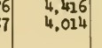 | `4,484` | `4,416` | neighbouring cell | box offset: model's box (no anchor): on Oct. 26's 4,014, three lines below Oct. 5 | [strip](citations_dev_v3/S0_ocr_02_context.png) |
| 3 | 1939-07_p085 `outstanding_forward_exchange_contracts` row total_sale_01, italy | 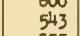 | `619` | `543` | neighbouring cell | box offset: model's box: on Apr. 19's 543, two lines below Apr. 5 | [strip](citations_dev_v3/S0_ocr_03_context.png) |
| 4 | 1939-07_p085 `outstanding_forward_exchange_contracts` row total_sale_04, other_europe |  | `17,479` | *(blank)* | unreadable crop | box offset: model's box: in the blank line before the next section | [strip](citations_dev_v3/S0_ocr_04_context.png) |
| 5 | 1939-12_p060 `outstanding_forward_exchange_contracts` row purchase_domestic_01, germany |  | `-` | *(blank)* | unreadable crop | box offset: model's box: between two columns, beside the dash | [strip](citations_dev_v3/S0_ocr_05_context.png) |
| 6 | 1939-08_p043 `receipts_and_expenditures_under_railroad` row 16, to_unemployment |  | `-` | `5.0` | unexplained | box offset: model's box: on July's 15.0, a line below June's dash | [strip](citations_dev_v3/S0_ocr_06_context.png) |
| 7 | 1939-08_p043 `receipts_and_expenditures_under_railroad` row 17, admin | 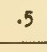 | `.5` | `5` | unexplained | re-read wrong: model's box on the right figure: the crop shows .5; the re-reader dropped the point | [strip](citations_dev_v3/S0_ocr_07_context.png) |
| 8 | 1939-10_p024 `receipts_and_expenditures_under_railroad` row 03, to_unemployment |  | `-` | *(blank)* | unreadable crop | box offset: model's box: between the dash columns | [strip](citations_dev_v3/S0_ocr_08_context.png) |
| 9 | 1939-12_p025 `receipts_and_expenditures_under_railroad` row 04, to_unemployment |  | `-` | *(blank)* | unreadable crop | box offset: model's box: between the dash columns | [strip](citations_dev_v3/S0_ocr_09_context.png) |
| 10 | 1939-01_p051 `short_term_foreign_liabilities_as` row 23, total_europe |  | `3,821` | `1,701` | unexplained | box offset: model's box: on the heading above Oct. 12 | [strip](citations_dev_v3/S0_ocr_10_context.png) |
| 11 | 1939-07_p071 `short_term_foreign_liabilities_as` row 05, all_other | 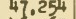 | `47,254` | `47,234` | unexplained | re-read wrong: anchored to the right figure: the crop shows 47,254; the re-reader read 47,234 | [strip](citations_dev_v3/S0_ocr_11_context.png) |
| 12 | 1939-12_p053 `short_term_foreign_liabilities_as` row 47, far_east | 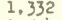 | `1,332` | `1, 332` | formatting only | formatting only: anchored to the right figure; the re-reader wrote 1, 332 | [strip](citations_dev_v3/S0_ocr_12_context.png) |
| 13 | 1982-06_p094 `total_claims_by_country` row asian_regional, c7 |  | `*` | *(blank)* | unreadable crop | box offset: model's box: on the regional heading, blank | [strip](citations_dev_v3/S0_ocr_13_context.png) |
| 14 | 1984-06_p058 `total_claims_by_country` row african_regional, c4 |  | `-` | `404,274` | unexplained | box offset: model's box: on Total foreign countries, rows above | [strip](citations_dev_v3/S0_ocr_14_context.png) |
| 15 | 1984-06_p058 `total_claims_by_country` row australia, c8 |  | `2,455` | `1,110` | unexplained | box offset: model's box: on Other Africa, rows above Australia | [strip](citations_dev_v3/S0_ocr_15_context.png) |
| 16 | 1984-06_p058 `total_claims_by_country` row belgium_luxembourg, c8 |  | `6,875` | `10,162` | unexplained | box offset: model's box: on Finland, rows below Belgium-Luxembourg | [strip](citations_dev_v3/S0_ocr_16_context.png) |
| 17 | 1984-06_p058 `total_claims_by_country` row peru, c7 |  | `2,715` | `683` | unexplained | box offset: model's box: on Uruguay, rows below Peru | [strip](citations_dev_v3/S0_ocr_17_context.png) |
| 18 | 1982-06_p091 `total_liabilities_by_country` row pakistan, c8 | 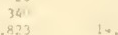 | `311` | `8.23` | unexplained | box offset: model's box: rows below Pakistan, faint print | [strip](citations_dev_v3/S0_ocr_18_context.png) |
| 19 | 1982-06_p091 `total_liabilities_by_country` row peru, c3 |  | `702` | `4,248` | unexplained | box offset: model's box: on Venezuela, rows below Peru | [strip](citations_dev_v3/S0_ocr_19_context.png) |
| 20 | 1982-06_p091 `total_liabilities_by_country` row poland, c6 |  | `36` | `301` | neighbouring cell | box offset: model's box: on Portugal, a row below Poland | [strip](citations_dev_v3/S0_ocr_20_context.png) |

## 20 disagreements under S0+grid, looked at

Drawn with `random.Random(2110)` from the 281 disagreements. Crop: what the re-reader saw. Context: the page around it, the box in red and the crop in blue. Judged: a reviewer's reading of the context strip and of the first read's row labels, where given; by Claude, in `results/templates/citations_dev_v3_causes.json`: box offset 11, re-read wrong 6, formatting only 1, unreadable crop 1, first read wrong 1

| # | Page, cell | Crop | First read | Re-read | By rule | Judged | Context |
|--:|---|---|---|---|---|---|---|
| 1 | 1939-01_p061 `outstanding_forward_exchange_contracts` row purchase_domestic_02, italy |  | `431` | `1,131` | unexplained | re-read wrong: anchored to the right figure: the crop shows 431; the re-reader read 1,131 | [strip](citations_dev_v3/S0_grid_01_context.png) |
| 2 | 1939-01_p061 `outstanding_forward_exchange_contracts` row total_sale_04, france | 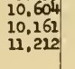 | `11,212` | `10,161` | neighbouring cell | box offset: grid box: its band spans three printed lines (a merged band left unsplit); the re-read took the middle one | [strip](citations_dev_v3/S0_grid_02_context.png) |
| 3 | 1939-12_p060 `outstanding_forward_exchange_contracts` row total_sale_01, latin_america |  | `3,513` | `3,512` | unexplained | re-read wrong: anchored to the right figure: the crop shows 3,513; the re-reader read 3,512 | [strip](citations_dev_v3/S0_grid_03_context.png) |
| 4 | 1939-08_p043 `receipts_and_expenditures_under_railroad` row 01, admin |  | `.3` | `1 3/2` | unreadable crop | box offset: model's box (no grid row): straddles .3 and 1.5 | [strip](citations_dev_v3/S0_grid_04_context.png) |
| 5 | 1939-08_p043 `receipts_and_expenditures_under_railroad` row 06, to_unemployment |  | `-` | *(blank)* | unreadable crop | formatting only: grid box on the right cell: the crop shows the nil dash, read as blank | [strip](citations_dev_v3/S0_grid_05_context.png) |
| 6 | 1939-12_p025 `receipts_and_expenditures_under_railroad` row 01, total_exp | 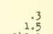 | `.3` | `1.5` | neighbouring cell | box offset: model's box (no grid row): straddles .3 and 1.5 | [strip](citations_dev_v3/S0_grid_06_context.png) |
| 7 | 1939-12_p025 `receipts_and_expenditures_under_railroad` row 07, to_unemployment |  | `-` | *(none)* | unreadable crop | unreadable crop: grid box: a band a few pixels tall, too thin to read | [strip](citations_dev_v3/S0_grid_07_context.png) |
| 8 | 1939-12_p025 `receipts_and_expenditures_under_railroad` row 10, to_unemployment |  | `-` | *(blank)* | unreadable crop | box offset: model's box (no grid row): beside the dash column | [strip](citations_dev_v3/S0_grid_08_context.png) |
| 9 | 1939-07_p075 `security_transactions_as_reported_by` row 04, france |  | `3,992` | `1,992` | unexplained | re-read wrong: anchored to the right figure: the crop shows 3,992; the re-reader read 1,992 | [strip](citations_dev_v3/S0_grid_09_context.png) |
| 10 | 1983-06_p092 `total_claims_by_country` row peru, c7 | 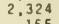 | `2,324` | `2,345` | unexplained | re-read wrong: anchored to the right figure: the crop shows 2,324; the re-reader read 2,345 | [strip](citations_dev_v3/S0_grid_10_context.png) |
| 11 | 1983-06_p092 `total_claims_by_country` row syria, c7 | 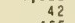 | `42` | `45` | unexplained | re-read wrong: grid box on the right cell: the crop shows 42; the re-reader read 45 | [strip](citations_dev_v3/S0_grid_11_context.png) |
| 12 | 1984-06_p058 `total_claims_by_country` row syria, c7 | 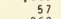 | `57` | `67` | unexplained | re-read wrong: grid box on the right cell: the crop shows a faint 57; the re-reader read 67 | [strip](citations_dev_v3/S0_grid_12_context.png) |
| 13 | 1982-06_p091 `total_liabilities_by_country` row taiwan, c8 |  | `2,214` | `466` | unexplained | box offset: model's box (no grid row on this page's Asia rows): rows off | [strip](citations_dev_v3/S0_grid_13_context.png) |
| 14 | 1983-06_p097 `total_liabilities_by_country` row australia, c4 | 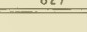 | `216` | `027` | unexplained | box offset: model's box (no grid on this page at all): on Total Africa | [strip](citations_dev_v3/S0_grid_14_context.png) |
| 15 | 1984-06_p055 `total_liabilities_by_country` row african_regional, c4 |  | `1` | *(blank)* | unreadable crop | box offset: model's box (no grid row): straddles two regional rows | [strip](citations_dev_v3/S0_grid_15_context.png) |
| 16 | 1984-06_p055 `total_liabilities_by_country` row asian_regional, c7 |  | `87` | `542` | neighbouring cell | box offset: model's box (no grid row): straddles two regional rows | [strip](citations_dev_v3/S0_grid_16_context.png) |
| 17 | 1984-06_p055 `total_liabilities_by_country` row china_mainland, c3 |  | `250` | `18,49` | unexplained | box offset: model's box (no grid row): rows below Mainland | [strip](citations_dev_v3/S0_grid_17_context.png) |
| 18 | 1984-06_p055 `total_liabilities_by_country` row china_mainland, c5 | 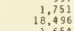 | `250` | `18,496` | unexplained | box offset: model's box (no grid row): rows below Mainland | [strip](citations_dev_v3/S0_grid_18_context.png) |
| 19 | 1984-06_p055 `total_liabilities_by_country` row france, c3 | 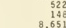 | `9,802` | *(none)* | unreadable crop | box offset: model's box (no grid row): rows below France | [strip](citations_dev_v3/S0_grid_19_context.png) |
| 20 | 1984-06_p055 `total_liabilities_by_country` row switzerland, c3 | 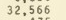 | `32,365` | `32,566` | unexplained | first read wrong: grid box on the right cell: the page prints 32,566 and the re-read agrees; the first read, 32,365, is wrong | [strip](citations_dev_v3/S0_grid_20_context.png) |
