# Box strategy for template tables, measured on development pages

Made by `python -m archivist.templates.compare_citations`. A measurement, reported whatever it shows. The pages are those the 1982-1994 templates were drafted from, in `templates/` and set aside in `results/templates/set_aside/` alike, all on the development side of `data/real/split.json`. On each page, up to 40 cells that the draft's identities need and that were read as a figure the first time are drawn with `random.Random(2110)`, and each is re-read blind from a crop of its box under both strategies: **S0+grid** as it was (the OCR layer's box, else the cell of the table's grid found in the page, where a read row is fixed by an anchored figure or its label in the OCR layer, else the model's; `grid.py`), and **S0+grid+order**, the same with the guarded order fallback: a page where nothing fixes a row but the grid finds exactly as many row bands as the read has rows maps them by order, kept only if at least 75% of 20 cells so mapped, re-read blind, agree with the first read; else the model's boxes stay. The re-reader runs at reasoning "minimal" (templates only). The measure is the share of sampled cells whose two reads agree, as the draft compares them; a failed or illegible re-read does not agree. Every sampled cell, with both reads, is in `results/templates/citations_dev_v4.json`. The earlier measurements are kept as written: `results/templates/citations_dev.md`, `results/templates/citations_dev_v2.md`, `results/templates/citations_dev_v3.md`; the sample is the same wherever the draft is.

Rule, fixed before running: the strategy with the higher share over all sampled cells becomes the template types' strategy; on a tie, the simpler (S0+grid). The ledger card and payment memo keep S0+ink, so no committed run changes.

Config: `{"drafter": {"backend": "meta", "model_id": "muse-spark-1.3-contributor"}, "extractor": {"backend": "meta", "model_id": "muse-spark-1.3-contributor"}, "rereader": {"backend": "meta", "model_id": "muse-spark-1.3-contributor"}}`

## Result

| Strategy | Cells agreeing | Share |
|---|--:|--:|
| S0+grid | 130 / 320 | 40.6% |
| S0+grid+order | 130 / 320 | 40.6% |

**Chosen for templates by the rule: S0+grid.**

## Where the boxes came from

Of the 4769 figure cells the sample is drawn from, how many boxes each strategy took from each source (ocr / grid / model):

| Strategy | ocr / grid / model |
|---|---|
| S0+grid | 977 (20%) / 1658 (35%) / 2134 (45%) |
| S0+grid+order | 977 (20%) / 1658 (35%) / 2134 (45%) |

Agreement among the sampled cells, by where each strategy's box came from:

| Strategy | Source | Sampled cells | Agree |
|---|---|--:|--:|
| S0+grid | ocr | 51 | 47 (92%) |
| S0+grid | grid | 93 | 72 (77%) |
| S0+grid | model | 176 | 11 (6%) |
| S0+grid+order | ocr | 51 | 47 (92%) |
| S0+grid+order | grid | 93 | 72 (77%) |
| S0+grid+order | model | 176 | 11 (6%) |

## Why cells disagree, by rule

Every disagreement, by the rule's cause (the module docstring defines them; "neighbouring cell" does not tell a box offset from a misplaced first read), except that a cell whose every re-read attempt ran out of tokens is "re-read out of tokens", not an unreadable crop (see Long re-reads).

| Strategy | Disagree | re-read out of tokens | unreadable crop | formatting only | neighbouring cell | unexplained |
|---|--:|--:|--:|--:|--:|--:|
| S0+grid | 190 | 1 (1%) | 61 (32%) | 7 (4%) | 19 (10%) | 102 (54%) |
| S0+grid+order | 190 | 1 (1%) | 61 (32%) | 7 (4%) | 19 (10%) | 102 (54%) |

## Long re-reads

Every cached answer to a sampled cell's re-read (first attempt, and the retry asked when it did not parse). Output tokens include the reasoning; the limit is 2048. An answer that reaches it is cut off; an empty or cut answer does not parse, so the re-read is asked once more, and when that fails too the cell has no second read (counted as not agreeing; its cause is "re-read out of tokens"). Answer text: the JSON that came back, whose length shows whether the answer itself ran long (over 200 tokens is about 800 characters).

| Strategy | Answers | Median tokens | Over 200 tokens | At the limit (empty) | Answer text over 800 chars | Cells with an answer at the limit, counted as |
|---|--:|--:|--:|--:|--:|---|
| S0+grid | 321 | 267 | 208 | 2 (2) | 0 | no second read 1 |
| S0+grid+order | 321 | 267 | 208 | 2 (2) | 0 | no second read 1 |

What some of them say:

- S0+grid, 1984-06_p054 row 07, off_other, first attempt, 2048 tokens: *(empty)* (first read `15,205`; counted as no second read)
- S0+grid, 1984-06_p054 row 07, off_other, retry attempt, 2048 tokens: *(empty)* (first read `15,205`; counted as no second read)
- S0+grid, 1982-06_p091 row panama, c2, first attempt, 359 tokens: `{"value": "5,521\n404"}` (first read `5,521`; counted as disagree)
- S0+grid+order, 1982-06_p091 row panama, c2, first attempt, 359 tokens: `{"value": "5,521\n404"}` (first read `5,521`; counted as disagree)
- S0+grid, 1983-06_p088 row 14, bank_time, first attempt, 250 tokens: `{"value": "19 7,122"}` (first read `28,267`; counted as disagree)

## Is the table's grid findable from the page alone?

Measured separately, in plain image code on the same pages: `results/templates/grid_dev.md` (`python -m archivist.templates.grid_probe`).

## By page

Boxes: where S0+grid+order's boxes for the page's figure cells came from, ocr / grid / model. Grid: the read's rows printing a figure, the row bands found, the rows fixed by an anchor or a label. Order fallback: tried only on a page with no fixed row and as many bands as rows; the guard's agreeing re-reads of those sampled, and whether it was kept.

| Family | Page | Sampled | S0+grid agree | S0+grid+order agree | S0+grid+order boxes (ocr / grid / model) | Grid (rows / bands / fixed) | Order fallback |
|---|---|--:|--:|--:|---|---|---|
| `total_claims_by_country` | 1982-06_p094 | 40 | 32 (80%) | 32 (80%) | 461 (67%) / 187 (27%) / 40 (6%) | 86 / 84 / 79 | not tried |
| `total_claims_by_country` | 1983-06_p092 | 40 | 34 (85%) | 34 (85%) | 457 (66%) / 199 (29%) / 32 (5%) | 86 / 88 / 80 | not tried |
| `total_claims_by_country` | 1984-06_p058 | 40 | 31 (78%) | 31 (78%) | 1 (0%) / 631 (92%) / 56 (8%) | 86 / 83 / 71 | not tried |
| `total_liabilities_by_country` | 1982-06_p091 | 40 | 19 (48%) | 19 (48%) | 26 (3%) / 545 (71%) / 196 (26%) | 86 / 98 / 77 | not tried |
| `total_liabilities_by_country` | 1983-06_p097 | 40 | 6 (15%) | 6 (15%) | 0 (0%) / 0 (0%) / 774 (100%) | 86 / 83 / 0 | not tried |
| `total_liabilities_by_country` | 1984-06_p055 | 40 | 8 (20%) | 8 (20%) | 32 (5%) / 96 (14%) / 560 (81%) | 86 / 95 / 13 | not tried |
| `total_liabilities_by_type_payable_in` | 1983-06_p088 | 40 | 0 (0%) | 0 (0%) | 0 (0%) / 0 (0%) / 238 (100%) | 17 / 19 / 0 | not tried |
| `total_liabilities_by_type_payable_in` | 1984-06_p054 | 40 | 0 (0%) | 0 (0%) | 0 (0%) / 0 (0%) / 238 (100%) | 17 / 18 / 0 | not tried |

## By family

| Family | Sampled | S0+grid | S0+grid+order | S0+grid boxes (ocr / grid / model) | S0+grid+order boxes (ocr / grid / model) |
|---|--:|--:|--:|---|---|
| `total_claims_by_country` | 120 | 97 (81%) | 97 (81%) | 919 (45%) / 1017 (49%) / 128 (6%) | 919 (45%) / 1017 (49%) / 128 (6%) |
| `total_liabilities_by_country` | 120 | 33 (28%) | 33 (28%) | 58 (3%) / 641 (29%) / 1530 (69%) | 58 (3%) / 641 (29%) / 1530 (69%) |
| `total_liabilities_by_type_payable_in` | 80 | 0 (0%) | 0 (0%) | 0 (0%) / 0 (0%) / 476 (100%) | 0 (0%) / 0 (0%) / 476 (100%) |

## 20 disagreements under S0+grid, looked at

Drawn with `random.Random(2110)` from the 190 disagreements. Crop: what the re-reader saw. Context: the page around it, the box in red and the crop in blue. Judged: a reviewer's reading of the context strip and of the first read's row labels, where given; in `results/templates/citations_dev_v4_causes.json`: not judged 20

| # | Page, cell | Crop | First read | Re-read | By rule | Judged | Context |
|--:|---|---|---|---|---|---|---|
| 1 | 1982-06_p094 `total_claims_by_country` row african_regional, c4 |  | `-` | `29` | unexplained | - | [strip](citations_dev_v4/S0_grid_01_context.png) |
| 2 | 1982-06_p094 `total_claims_by_country` row total_other_countries, c6 | 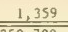 | `1,359` | `1, 359` | formatting only | - | [strip](citations_dev_v4/S0_grid_02_context.png) |
| 3 | 1982-06_p091 `total_liabilities_by_country` row ghana, c6 |  | `51` | `5` | unreadable crop | - | [strip](citations_dev_v4/S0_grid_03_context.png) |
| 4 | 1982-06_p091 `total_liabilities_by_country` row india, c8 |  | `437` | *(none)* | unreadable crop | - | [strip](citations_dev_v4/S0_grid_04_context.png) |
| 5 | 1982-06_p091 `total_liabilities_by_country` row latin_american_regional, c9 |  | `48` | `65` | unexplained | - | [strip](citations_dev_v4/S0_grid_05_context.png) |
| 6 | 1982-06_p091 `total_liabilities_by_country` row total_foreign, c5 |  | `243,563` | `714` | unexplained | - | [strip](citations_dev_v4/S0_grid_06_context.png) |
| 7 | 1982-06_p091 `total_liabilities_by_country` row venezuela, c7 |  | `4,576` | *(blank)* | unreadable crop | - | [strip](citations_dev_v4/S0_grid_07_context.png) |
| 8 | 1983-06_p097 `total_liabilities_by_country` row belgium_luxembourg, c1 |  | `424` | `1` | neighbouring cell | - | [strip](citations_dev_v4/S0_grid_08_context.png) |
| 9 | 1983-06_p097 `total_liabilities_by_country` row netherlands, c3 |  | `1,056` | `6` | unreadable crop | - | [strip](citations_dev_v4/S0_grid_09_context.png) |
| 10 | 1984-06_p055 `total_liabilities_by_country` row middle_eastern_regional, c6 | 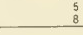 | `8` | `5` | neighbouring cell | - | [strip](citations_dev_v4/S0_grid_10_context.png) |
| 11 | 1984-06_p055 `total_liabilities_by_country` row singapore, c1 |  | `2,628` | *(none)* | unreadable crop | - | [strip](citations_dev_v4/S0_grid_11_context.png) |
| 12 | 1984-06_p055 `total_liabilities_by_country` row total_international, c5 | 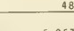 | `6,057` | `48` | neighbouring cell | - | [strip](citations_dev_v4/S0_grid_12_context.png) |
| 13 | 1984-06_p055 `total_liabilities_by_country` row trinidad_tobago, c2 | 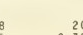 | `425` | *(blank)* | unreadable crop | - | [strip](citations_dev_v4/S0_grid_13_context.png) |
| 14 | 1983-06_p088 `total_liabilities_by_type_payable_in` row 08, off_time |  | `5,400` | `518` | unexplained | - | [strip](citations_dev_v4/S0_grid_14_context.png) |
| 15 | 1983-06_p088 `total_liabilities_by_type_payable_in` row 08, oth_demand |  | `4,544` | `29,843` | unexplained | - | [strip](citations_dev_v4/S0_grid_15_context.png) |
| 16 | 1983-06_p088 `total_liabilities_by_type_payable_in` row 09, oth_time | 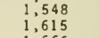 | `27,529` | `1,548` | unexplained | - | [strip](citations_dev_v4/S0_grid_16_context.png) |
| 17 | 1983-06_p088 `total_liabilities_by_type_payable_in` row 10, bank_own |  | `116,802` | `5,093` | unexplained | - | [strip](citations_dev_v4/S0_grid_17_context.png) |
| 18 | 1983-06_p088 `total_liabilities_by_type_payable_in` row 11, off_bills | 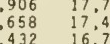 | `44,450` | `432` | unexplained | - | [strip](citations_dev_v4/S0_grid_18_context.png) |
| 19 | 1984-06_p054 `total_liabilities_by_type_payable_in` row 03, bank_other |  | `23,792` | `1` | unexplained | - | [strip](citations_dev_v4/S0_grid_19_context.png) |
| 20 | 1984-06_p054 `total_liabilities_by_type_payable_in` row 04, bank_bills |  | `10,178` | `25,591` | unexplained | - | [strip](citations_dev_v4/S0_grid_20_context.png) |

## 20 disagreements under S0+grid+order, looked at

Drawn with `random.Random(2110)` from the 190 disagreements. Crop: what the re-reader saw. Context: the page around it, the box in red and the crop in blue. Judged: a reviewer's reading of the context strip and of the first read's row labels, where given; in `results/templates/citations_dev_v4_causes.json`: not judged 20

| # | Page, cell | Crop | First read | Re-read | By rule | Judged | Context |
|--:|---|---|---|---|---|---|---|
| 1 | 1982-06_p094 `total_claims_by_country` row african_regional, c4 |  | `-` | `29` | unexplained | - | [strip](citations_dev_v4/S0_grid_order_01_context.png) |
| 2 | 1982-06_p094 `total_claims_by_country` row total_other_countries, c6 |  | `1,359` | `1, 359` | formatting only | - | [strip](citations_dev_v4/S0_grid_order_02_context.png) |
| 3 | 1982-06_p091 `total_liabilities_by_country` row ghana, c6 |  | `51` | `5` | unreadable crop | - | [strip](citations_dev_v4/S0_grid_order_03_context.png) |
| 4 | 1982-06_p091 `total_liabilities_by_country` row india, c8 |  | `437` | *(none)* | unreadable crop | - | [strip](citations_dev_v4/S0_grid_order_04_context.png) |
| 5 | 1982-06_p091 `total_liabilities_by_country` row latin_american_regional, c9 |  | `48` | `65` | unexplained | - | [strip](citations_dev_v4/S0_grid_order_05_context.png) |
| 6 | 1982-06_p091 `total_liabilities_by_country` row total_foreign, c5 |  | `243,563` | `714` | unexplained | - | [strip](citations_dev_v4/S0_grid_order_06_context.png) |
| 7 | 1982-06_p091 `total_liabilities_by_country` row venezuela, c7 |  | `4,576` | *(blank)* | unreadable crop | - | [strip](citations_dev_v4/S0_grid_order_07_context.png) |
| 8 | 1983-06_p097 `total_liabilities_by_country` row belgium_luxembourg, c1 | 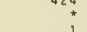 | `424` | `1` | neighbouring cell | - | [strip](citations_dev_v4/S0_grid_order_08_context.png) |
| 9 | 1983-06_p097 `total_liabilities_by_country` row netherlands, c3 |  | `1,056` | `6` | unreadable crop | - | [strip](citations_dev_v4/S0_grid_order_09_context.png) |
| 10 | 1984-06_p055 `total_liabilities_by_country` row middle_eastern_regional, c6 |  | `8` | `5` | neighbouring cell | - | [strip](citations_dev_v4/S0_grid_order_10_context.png) |
| 11 | 1984-06_p055 `total_liabilities_by_country` row singapore, c1 | 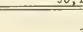 | `2,628` | *(none)* | unreadable crop | - | [strip](citations_dev_v4/S0_grid_order_11_context.png) |
| 12 | 1984-06_p055 `total_liabilities_by_country` row total_international, c5 |  | `6,057` | `48` | neighbouring cell | - | [strip](citations_dev_v4/S0_grid_order_12_context.png) |
| 13 | 1984-06_p055 `total_liabilities_by_country` row trinidad_tobago, c2 |  | `425` | *(blank)* | unreadable crop | - | [strip](citations_dev_v4/S0_grid_order_13_context.png) |
| 14 | 1983-06_p088 `total_liabilities_by_type_payable_in` row 08, off_time | 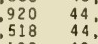 | `5,400` | `518` | unexplained | - | [strip](citations_dev_v4/S0_grid_order_14_context.png) |
| 15 | 1983-06_p088 `total_liabilities_by_type_payable_in` row 08, oth_demand | 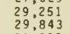 | `4,544` | `29,843` | unexplained | - | [strip](citations_dev_v4/S0_grid_order_15_context.png) |
| 16 | 1983-06_p088 `total_liabilities_by_type_payable_in` row 09, oth_time |  | `27,529` | `1,548` | unexplained | - | [strip](citations_dev_v4/S0_grid_order_16_context.png) |
| 17 | 1983-06_p088 `total_liabilities_by_type_payable_in` row 10, bank_own | 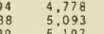 | `116,802` | `5,093` | unexplained | - | [strip](citations_dev_v4/S0_grid_order_17_context.png) |
| 18 | 1983-06_p088 `total_liabilities_by_type_payable_in` row 11, off_bills |  | `44,450` | `432` | unexplained | - | [strip](citations_dev_v4/S0_grid_order_18_context.png) |
| 19 | 1984-06_p054 `total_liabilities_by_type_payable_in` row 03, bank_other | 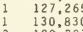 | `23,792` | `1` | unexplained | - | [strip](citations_dev_v4/S0_grid_order_19_context.png) |
| 20 | 1984-06_p054 `total_liabilities_by_type_payable_in` row 04, bank_bills | 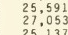 | `10,178` | `25,591` | unexplained | - | [strip](citations_dev_v4/S0_grid_order_20_context.png) |
