# Box strategy for template tables, measured on development pages

Made by `python -m archivist.templates.compare_citations`. A measurement, reported whatever it shows. The pages are those every template in `templates/` was drafted from, and those of the 1982-1994 templates set aside in `results/templates/set_aside/`, all on the development side of `data/real/split.json`. On each page, up to 40 cells that the draft's identities need and that were read as a figure the first time are drawn with `random.Random(2110)`, and each is re-read blind from a crop of its box under both strategies: **S0+grid** as built (the OCR layer's box, else the cell of the table's grid found in the page, else the model's, with the guarded order fallback; `grid.py`), and **S0+grid+rules**, the same with the table's body bounded by its horizontal rules: a band sitting on a rule is the rule's leftover stroke and is dropped, and of the stretches between rules the one whose band count is closest to the read's printed rows is kept. The re-reader runs at reasoning "minimal" (templates only). The measure is the share of sampled cells whose two reads agree, as the draft compares them; a failed or illegible re-read does not agree. Every sampled cell, with both reads, is in `results/templates/citations_dev_v5.json`. The earlier measurements are kept as written: `results/templates/citations_dev.md`, `results/templates/citations_dev_v2.md`, `results/templates/citations_dev_v3.md`, `results/templates/citations_dev_v4.md`; the sample is the same wherever the draft is.

Rule, fixed before running: the strategy with the higher share over all sampled cells becomes the template types' strategy; on a tie, the simpler (S0+grid). The ledger card and payment memo keep S0+ink, so no committed run changes.

Config: `{"drafter": {"backend": "meta", "model_id": "muse-spark-1.3-contributor"}, "extractor": {"backend": "meta", "model_id": "muse-spark-1.3-contributor"}, "rereader": {"backend": "meta", "model_id": "muse-spark-1.3-contributor"}}`

## Result

| Strategy | Cells agreeing | Share |
|---|--:|--:|
| S0+grid | 439 / 800 | 54.9% |
| S0+grid+rules | 451 / 800 | 56.4% |

**Chosen for templates by the rule: S0+grid+rules.**

## Where the boxes came from

Of the 9328 figure cells the sample is drawn from, how many boxes each strategy took from each source (ocr / grid / model):

| Strategy | ocr / grid / model |
|---|---|
| S0+grid | 3367 (36%) / 3162 (34%) / 2799 (30%) |
| S0+grid+rules | 3367 (36%) / 3482 (37%) / 2479 (27%) |

Agreement among the sampled cells, by where each strategy's box came from:

| Strategy | Source | Sampled cells | Agree |
|---|---|--:|--:|
| S0+grid | ocr | 277 | 230 (83%) |
| S0+grid | grid | 268 | 180 (67%) |
| S0+grid | model | 255 | 29 (11%) |
| S0+grid+rules | ocr | 277 | 230 (83%) |
| S0+grid+rules | grid | 287 | 192 (67%) |
| S0+grid+rules | model | 236 | 29 (12%) |

## Why cells disagree, by rule

Every disagreement, by the rule's cause (the module docstring defines them; "neighbouring cell" does not tell a box offset from a misplaced first read), except that a cell whose every re-read attempt ran out of tokens is "re-read out of tokens", not an unreadable crop (see Long re-reads).

| Strategy | Disagree | re-read out of tokens | unreadable crop | formatting only | neighbouring cell | unexplained |
|---|--:|--:|--:|--:|--:|--:|
| S0+grid | 361 | 1 (0%) | 109 (30%) | 13 (4%) | 59 (16%) | 179 (50%) |
| S0+grid+rules | 349 | 1 (0%) | 102 (29%) | 13 (4%) | 59 (17%) | 174 (50%) |

## Long re-reads

Every cached answer to a sampled cell's re-read (first attempt, and the retry asked when it did not parse). Output tokens include the reasoning; the limit is 2048. An answer that reaches it is cut off; an empty or cut answer does not parse, so the re-read is asked once more, and when that fails too the cell has no second read (counted as not agreeing; its cause is "re-read out of tokens"). Answer text: the JSON that came back, whose length shows whether the answer itself ran long (over 200 tokens is about 800 characters).

| Strategy | Answers | Median tokens | Over 200 tokens | At the limit (empty) | Answer text over 800 chars | Cells with an answer at the limit, counted as |
|---|--:|--:|--:|--:|--:|---|
| S0+grid | 801 | 217 | 440 | 2 (2) | 0 | no second read 1 |
| S0+grid+rules | 801 | 216 | 434 | 2 (2) | 0 | no second read 1 |

What some of them say:

- S0+grid, 1984-06_p054 row 07, off_other, first attempt, 2048 tokens: *(empty)* (first read `15,205`; counted as no second read)
- S0+grid, 1984-06_p054 row 07, off_other, retry attempt, 2048 tokens: *(empty)* (first read `15,205`; counted as no second read)
- S0+grid, 1982-06_p091 row panama, c2, first attempt, 359 tokens: `{"value": "5,521\n404"}` (first read `5,521`; counted as disagree)
- S0+grid+rules, 1982-06_p091 row panama, c2, first attempt, 359 tokens: `{"value": "5,521\n404"}` (first read `5,521`; counted as disagree)
- S0+grid, 1939-07_p071 row 06, total_europe, first attempt, 167 tokens: `{"value": "1,629,410"}` (first read `1,629,410`; counted as agree)

## Is the table's grid findable from the page alone?

Measured separately, in plain image code on the same pages: `results/templates/grid_dev.md` (`python -m archivist.templates.grid_probe`).

## By page

Boxes: where S0+grid+rules's boxes for the page's figure cells came from, ocr / grid / model. Rows / bands / fixed: the read's rows printing a figure, the row bands found and the rows fixed by an anchor or a label, without and with the rules bounding the body. Order fallback: tried only on a page with no fixed row and as many bands as rows; the guard's agreeing re-reads of those sampled, and whether it was kept.

| Family | Page | Sampled | S0+grid agree | S0+grid+rules agree | S0+grid+rules boxes (ocr / grid / model) | Rows / bands / fixed, unbounded → bounded | S0+grid+rules order fallback |
|---|---|--:|--:|--:|---|---|---|
| `outstanding_forward_exchange_contracts` | 1939-01_p061 | 40 | 24 (60%) | 24 (60%) | 221 (71%) / 91 (29%) / 0 (0%) | 24 / 16 → 15 / 24 → 24 | not tried |
| `outstanding_forward_exchange_contracts` | 1939-07_p085 | 40 | 9 (22%) | 9 (22%) | 21 (5%) / 196 (50%) / 173 (44%) | 30 / 16 → 16 / 24 → 24 | not tried |
| `outstanding_forward_exchange_contracts` | 1939-12_p060 | 40 | 29 (72%) | 29 (72%) | 231 (74%) / 52 (17%) / 29 (9%) | 24 / 21 → 21 / 23 → 23 | not tried |
| `receipts_and_expenditures_under_railroad` | 1939-08_p043 | 40 | 27 (68%) | 27 (68%) | 18 (26%) / 42 (62%) / 8 (12%) | 17 / 19 → 19 / 13 → 13 | not tried |
| `receipts_and_expenditures_under_railroad` | 1939-10_p024 | 40 | 29 (72%) | 29 (72%) | 18 (26%) / 34 (50%) / 16 (24%) | 17 / 17 → 17 / 12 → 12 | not tried |
| `receipts_and_expenditures_under_railroad` | 1939-12_p025 | 40 | 21 (52%) | 21 (52%) | 20 (29%) / 36 (53%) / 12 (18%) | 17 / 18 → 18 / 13 → 13 | not tried |
| `security_transactions_as_reported_by` | 1939-01_p055 | 40 | 25 (62%) | 25 (62%) | 318 (51%) / 306 (49%) / 0 (0%) | 48 / 48 → 48 / 48 → 48 | not tried |
| `security_transactions_as_reported_by` | 1939-07_p075 | 40 | 30 (75%) | 30 (75%) | 142 (27%) / 365 (70%) / 13 (2%) | 40 / 44 → 44 / 38 → 38 | not tried |
| `security_transactions_as_reported_by` | 1939-12_p055 | 40 | 30 (75%) | 30 (75%) | 287 (46%) / 300 (48%) / 37 (6%) | 48 / 47 → 47 / 45 → 45 | not tried |
| `short_term_foreign_liabilities_as` | 1939-01_p051 | 40 | 28 (70%) | 28 (70%) | 353 (68%) / 21 (4%) / 146 (28%) | 40 / 40 → 40 / 39 → 39 | not tried |
| `short_term_foreign_liabilities_as` | 1939-07_p071 | 40 | 28 (70%) | 28 (70%) | 383 (72%) / 61 (11%) / 89 (17%) | 41 / 42 → 42 / 39 → 39 | not tried |
| `short_term_foreign_liabilities_as` | 1939-12_p053 | 40 | 29 (72%) | 29 (72%) | 378 (73%) / 0 (0%) / 142 (27%) | 40 / 0 → 0 / 0 → 0 | not tried |
| `total_claims_by_country` | 1982-06_p094 | 40 | 32 (80%) | 32 (80%) | 461 (67%) / 195 (28%) / 32 (5%) | 86 / 84 → 82 / 79 → 80 | not tried |
| `total_claims_by_country` | 1983-06_p092 | 40 | 34 (85%) | 35 (88%) | 457 (66%) / 215 (31%) / 16 (2%) | 86 / 88 → 85 / 80 → 80 | not tried |
| `total_claims_by_country` | 1984-06_p058 | 40 | 31 (78%) | 31 (78%) | 1 (0%) / 647 (94%) / 40 (6%) | 86 / 83 → 81 / 71 → 71 | not tried |
| `total_liabilities_by_country` | 1982-06_p091 | 40 | 19 (48%) | 17 (42%) | 26 (3%) / 505 (66%) / 236 (31%) | 86 / 98 → 86 / 77 → 72 | not tried |
| `total_liabilities_by_country` | 1983-06_p097 | 40 | 6 (15%) | 6 (15%) | 0 (0%) / 0 (0%) / 774 (100%) | 86 / 83 → 78 / 0 → 0 | not tried |
| `total_liabilities_by_country` | 1984-06_p055 | 40 | 8 (20%) | 21 (52%) | 32 (5%) / 416 (60%) / 240 (35%) | 86 / 95 → 86 / 13 → 13 | not tried |
| `total_liabilities_by_type_payable_in` | 1983-06_p088 | 40 | 0 (0%) | 0 (0%) | 0 (0%) / 0 (0%) / 238 (100%) | 17 / 19 → 17 / 0 → 0 | refused: 3 of 20 agree |
| `total_liabilities_by_type_payable_in` | 1984-06_p054 | 40 | 0 (0%) | 0 (0%) | 0 (0%) / 0 (0%) / 238 (100%) | 17 / 18 → 18 / 0 → 0 | not tried |

## By family

| Family | Sampled | S0+grid | S0+grid+rules | S0+grid boxes (ocr / grid / model) | S0+grid+rules boxes (ocr / grid / model) |
|---|--:|--:|--:|---|---|
| `outstanding_forward_exchange_contracts` | 120 | 62 (52%) | 62 (52%) | 473 (47%) / 339 (33%) / 202 (20%) | 473 (47%) / 339 (33%) / 202 (20%) |
| `receipts_and_expenditures_under_railroad` | 120 | 77 (64%) | 77 (64%) | 56 (27%) / 112 (55%) / 36 (18%) | 56 (27%) / 112 (55%) / 36 (18%) |
| `security_transactions_as_reported_by` | 120 | 85 (71%) | 85 (71%) | 747 (42%) / 971 (55%) / 50 (3%) | 747 (42%) / 971 (55%) / 50 (3%) |
| `short_term_foreign_liabilities_as` | 120 | 85 (71%) | 85 (71%) | 1114 (71%) / 82 (5%) / 377 (24%) | 1114 (71%) / 82 (5%) / 377 (24%) |
| `total_claims_by_country` | 120 | 97 (81%) | 98 (82%) | 919 (45%) / 1017 (49%) / 128 (6%) | 919 (45%) / 1057 (51%) / 88 (4%) |
| `total_liabilities_by_country` | 120 | 33 (28%) | 44 (37%) | 58 (3%) / 641 (29%) / 1530 (69%) | 58 (3%) / 921 (41%) / 1250 (56%) |
| `total_liabilities_by_type_payable_in` | 80 | 0 (0%) | 0 (0%) | 0 (0%) / 0 (0%) / 476 (100%) | 0 (0%) / 0 (0%) / 476 (100%) |

## 20 disagreements under S0+grid, looked at

Drawn with `random.Random(2110)` from the 361 disagreements. Crop: what the re-reader saw. Context: the page around it, the box in red and the crop in blue. Judged: a reviewer's reading of the context strip and of the first read's row labels, where given; in `results/templates/citations_dev_v5_causes.json`: not judged 20

| # | Page, cell | Crop | First read | Re-read | By rule | Judged | Context |
|--:|---|---|---|---|---|---|---|
| 1 | 1939-01_p061 `outstanding_forward_exchange_contracts` row purchase_domestic_02, italy |  | `431` | `1,131` | unexplained | - | [strip](citations_dev_v5/S0_grid_01_context.png) |
| 2 | 1939-01_p061 `outstanding_forward_exchange_contracts` row total_sale_04, france |  | `11,212` | `10,161` | neighbouring cell | - | [strip](citations_dev_v5/S0_grid_02_context.png) |
| 3 | 1939-12_p060 `outstanding_forward_exchange_contracts` row total_sale_01, latin_america |  | `3,513` | `3,512` | unexplained | - | [strip](citations_dev_v5/S0_grid_03_context.png) |
| 4 | 1939-08_p043 `receipts_and_expenditures_under_railroad` row 01, admin |  | `.3` | `1 3/2` | unreadable crop | - | [strip](citations_dev_v5/S0_grid_04_context.png) |
| 5 | 1939-08_p043 `receipts_and_expenditures_under_railroad` row 06, to_unemployment |  | `-` | *(blank)* | unreadable crop | - | [strip](citations_dev_v5/S0_grid_05_context.png) |
| 6 | 1939-12_p025 `receipts_and_expenditures_under_railroad` row 01, total_exp |  | `.3` | `1.5` | neighbouring cell | - | [strip](citations_dev_v5/S0_grid_06_context.png) |
| 7 | 1939-12_p025 `receipts_and_expenditures_under_railroad` row 07, to_unemployment |  | `-` | *(none)* | unreadable crop | - | [strip](citations_dev_v5/S0_grid_07_context.png) |
| 8 | 1939-12_p025 `receipts_and_expenditures_under_railroad` row 10, to_unemployment |  | `-` | *(blank)* | unreadable crop | - | [strip](citations_dev_v5/S0_grid_08_context.png) |
| 9 | 1939-07_p075 `security_transactions_as_reported_by` row 04, france |  | `3,992` | `1,992` | unexplained | - | [strip](citations_dev_v5/S0_grid_09_context.png) |
| 10 | 1983-06_p092 `total_claims_by_country` row syria, c7 |  | `42` | `45` | unexplained | - | [strip](citations_dev_v5/S0_grid_10_context.png) |
| 11 | 1984-06_p058 `total_claims_by_country` row syria, c7 |  | `57` | `67` | unexplained | - | [strip](citations_dev_v5/S0_grid_11_context.png) |
| 12 | 1982-06_p091 `total_liabilities_by_country` row taiwan, c8 | 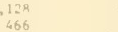 | `2,214` | `466` | unexplained | - | [strip](citations_dev_v5/S0_grid_12_context.png) |
| 13 | 1983-06_p097 `total_liabilities_by_country` row australia, c4 |  | `216` | `027` | unexplained | - | [strip](citations_dev_v5/S0_grid_13_context.png) |
| 14 | 1984-06_p055 `total_liabilities_by_country` row asian_regional, c7 |  | `87` | `542` | neighbouring cell | - | [strip](citations_dev_v5/S0_grid_14_context.png) |
| 15 | 1984-06_p055 `total_liabilities_by_country` row china_mainland, c3 |  | `250` | `18,49` | unexplained | - | [strip](citations_dev_v5/S0_grid_15_context.png) |
| 16 | 1984-06_p055 `total_liabilities_by_country` row china_mainland, c5 |  | `250` | `18,496` | unexplained | - | [strip](citations_dev_v5/S0_grid_16_context.png) |
| 17 | 1984-06_p055 `total_liabilities_by_country` row switzerland, c3 |  | `32,365` | `32,566` | unexplained | - | [strip](citations_dev_v5/S0_grid_17_context.png) |
| 18 | 1983-06_p088 `total_liabilities_by_type_payable_in` row 14, bank_time | 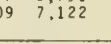 | `28,267` | `19 7,122` | unexplained | - | [strip](citations_dev_v5/S0_grid_18_context.png) |
| 19 | 1983-06_p088 `total_liabilities_by_type_payable_in` row 14, total | 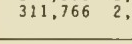 | `300,723` | `311,766` | unexplained | - | [strip](citations_dev_v5/S0_grid_19_context.png) |
| 20 | 1983-06_p088 `total_liabilities_by_type_payable_in` row 15, bank_bills | 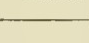 | `6,292` | *(blank)* | unreadable crop | - | [strip](citations_dev_v5/S0_grid_20_context.png) |

## 20 disagreements under S0+grid+rules, looked at

Drawn with `random.Random(2110)` from the 349 disagreements. Crop: what the re-reader saw. Context: the page around it, the box in red and the crop in blue. Judged: a reviewer's reading of the context strip and of the first read's row labels, where given; in `results/templates/citations_dev_v5_causes.json`: not judged 20

| # | Page, cell | Crop | First read | Re-read | By rule | Judged | Context |
|--:|---|---|---|---|---|---|---|
| 1 | 1939-01_p061 `outstanding_forward_exchange_contracts` row purchase_domestic_02, italy | 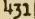 | `431` | `1,131` | unexplained | - | [strip](citations_dev_v5/S0_grid_rules_01_context.png) |
| 2 | 1939-01_p061 `outstanding_forward_exchange_contracts` row total_sale_04, france |  | `11,212` | `10,161` | neighbouring cell | - | [strip](citations_dev_v5/S0_grid_rules_02_context.png) |
| 3 | 1939-12_p060 `outstanding_forward_exchange_contracts` row total_sale_01, latin_america | 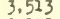 | `3,513` | `3,512` | unexplained | - | [strip](citations_dev_v5/S0_grid_rules_03_context.png) |
| 4 | 1939-08_p043 `receipts_and_expenditures_under_railroad` row 01, admin | 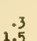 | `.3` | `1 3/2` | unreadable crop | - | [strip](citations_dev_v5/S0_grid_rules_04_context.png) |
| 5 | 1939-08_p043 `receipts_and_expenditures_under_railroad` row 06, to_unemployment |  | `-` | *(blank)* | unreadable crop | - | [strip](citations_dev_v5/S0_grid_rules_05_context.png) |
| 6 | 1939-12_p025 `receipts_and_expenditures_under_railroad` row 01, total_exp |  | `.3` | `1.5` | neighbouring cell | - | [strip](citations_dev_v5/S0_grid_rules_06_context.png) |
| 7 | 1939-12_p025 `receipts_and_expenditures_under_railroad` row 07, to_unemployment |  | `-` | *(none)* | unreadable crop | - | [strip](citations_dev_v5/S0_grid_rules_07_context.png) |
| 8 | 1939-12_p025 `receipts_and_expenditures_under_railroad` row 10, to_unemployment |  | `-` | *(blank)* | unreadable crop | - | [strip](citations_dev_v5/S0_grid_rules_08_context.png) |
| 9 | 1939-07_p075 `security_transactions_as_reported_by` row 04, france |  | `3,992` | `1,992` | unexplained | - | [strip](citations_dev_v5/S0_grid_rules_09_context.png) |
| 10 | 1983-06_p092 `total_claims_by_country` row syria, c7 |  | `42` | `45` | unexplained | - | [strip](citations_dev_v5/S0_grid_rules_10_context.png) |
| 11 | 1984-06_p058 `total_claims_by_country` row total_international_regional, c5 |  | `426` | `354` | unexplained | - | [strip](citations_dev_v5/S0_grid_rules_11_context.png) |
| 12 | 1982-06_p091 `total_liabilities_by_country` row switzerland, c3 | 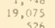 | `19,075` | `19,526` | unexplained | - | [strip](citations_dev_v5/S0_grid_rules_12_context.png) |
| 13 | 1983-06_p097 `total_liabilities_by_country` row african_regional, c4 |  | `-` | `*` | neighbouring cell | - | [strip](citations_dev_v5/S0_grid_rules_13_context.png) |
| 14 | 1984-06_p055 `total_liabilities_by_country` row african_regional, c4 |  | `1` | *(blank)* | unreadable crop | - | [strip](citations_dev_v5/S0_grid_rules_14_context.png) |
| 15 | 1984-06_p055 `total_liabilities_by_country` row belgium_luxembourg, c8 | 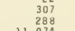 | `3,901` | `298` | unexplained | - | [strip](citations_dev_v5/S0_grid_rules_15_context.png) |
| 16 | 1984-06_p055 `total_liabilities_by_country` row european_regional, c3 | 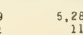 | `111` | `5,26` | unexplained | - | [strip](citations_dev_v5/S0_grid_rules_16_context.png) |
| 17 | 1983-06_p088 `total_liabilities_by_type_payable_in` row 01, bank_bills | 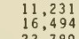 | `422` | `16,494` | unexplained | - | [strip](citations_dev_v5/S0_grid_rules_17_context.png) |
| 18 | 1984-06_p054 `total_liabilities_by_type_payable_in` row 01, off_other | 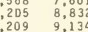 | `22,997` | `9,13` | unexplained | - | [strip](citations_dev_v5/S0_grid_rules_18_context.png) |
| 19 | 1984-06_p054 `total_liabilities_by_type_payable_in` row 03, bank_bills | 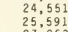 | `5,809` | `24,551` | unexplained | - | [strip](citations_dev_v5/S0_grid_rules_19_context.png) |
| 20 | 1984-06_p054 `total_liabilities_by_type_payable_in` row 03, bank_demand | 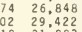 | `8,675` | `26,848` | unexplained | - | [strip](citations_dev_v5/S0_grid_rules_20_context.png) |
